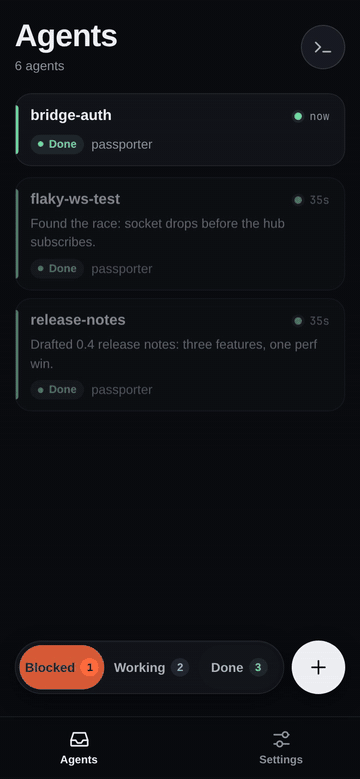
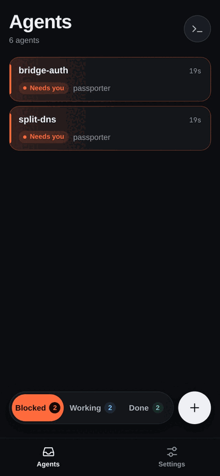
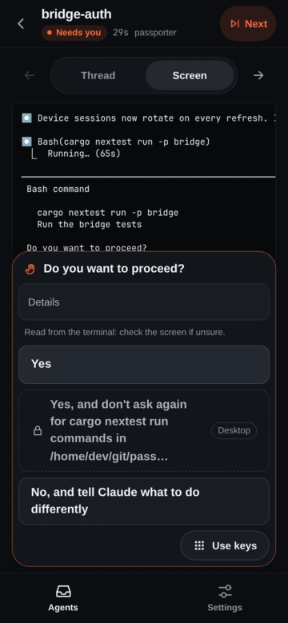
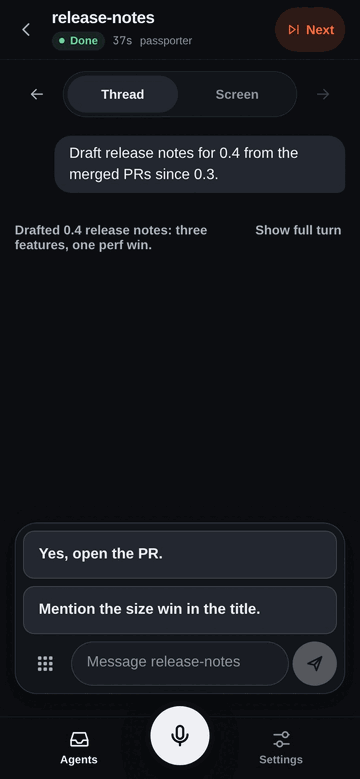
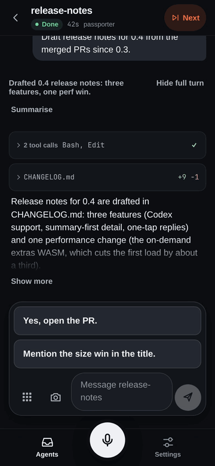
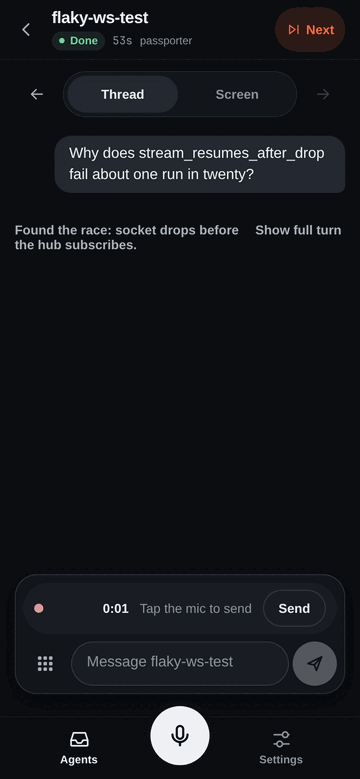
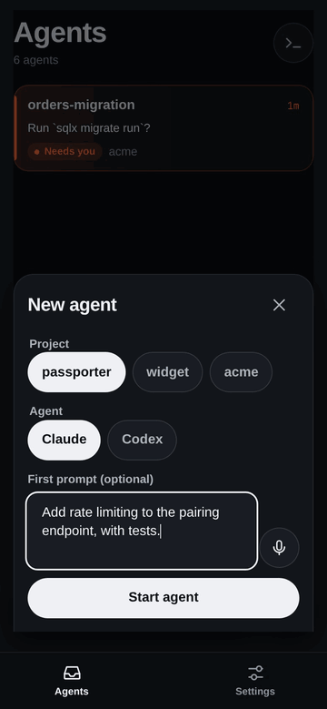
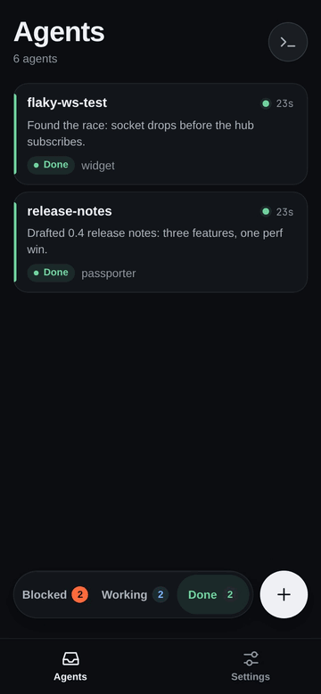

# Passporter

**A phone inbox for the coding agents running on your dev box.** Passporter
is a mobile-first, voice-first control surface for Claude Code and Codex
agents running in [herdr](https://herdr.dev): see who needs you, answer in
one tap, or just say it.

<p align="center">
  
</p>

## Triage at a glance

Every agent herdr runs, sorted into **Blocked**, **Working** and **Done**.
Blocked comes first. The list is live over a WebSocket, cached for offline
viewing, and Web Push pings you (content-free) when an agent is blocked or
done.

<p align="center">
  
</p>

## Approve in one tap

Permission prompts become buttons. Risky options (*always allow*,
*bypass*) are marked as such and locked to the desktop: never a one-tap
answer. When the parser is unsure, the agent's screen and a keypad are
right there.

<p align="center">
  
</p>

## Long turns, summarised

Each turn leads with a one-line headline. The full reply and the tool calls
are one tap away. Headlines, TL;DRs and reply suggestions come from your
own `claude` CLI login, and are optional.

<p align="center">
  
</p>

## Or just say it

When an agent asks a question, likely answers are one tap away. Or tap the
mic and say it: dictation runs on [whisper.cpp](https://github.com/ggml-org/whisper.cpp)
on your own machine (a GPU makes it fast; the CPU works with a smaller
model), and audio never leaves it. Queued replies survive dead zones, and
never send stale.

<p align="center">
  
  &nbsp;
  
</p>

## Start new agents

Pick a repo, describe the task, and herdr opens a fresh tab on the dev box.
Projects, agent kinds and runbooks come from allowlists you configure:
never a free-form shell.

<p align="center">
  
</p>

## Built in Rust, end to end

An axum bridge and a Leptos/WASM PWA share one set of protocol types, so an
API mismatch is a build error. Self-hosted: the bridge listens on loopback,
and you reach it over Tailscale, WireGuard or your own HTTPS proxy. Works
with Claude Code and Codex. A native Android app (Tauri, with notification
replies and Android Auto) is **planned, not shipped**: today Passporter is
a PWA, used daily in Chrome on Android.

<p align="center">
  
</p>

| Agent | List, state, prompt, keys, screen | Thread | Dialog buttons | Hooks |
|---|---|---|---|---|
| Claude Code (tested 2.1.x) | yes | yes | yes | yes |
| Codex CLI (tested 0.166+) | yes | yes | yes | no |
| Other herdr agents | yes | no | no | no |

Dialog parsing reads the agent's screen, so a new Claude Code or Codex
release can change what parses. Below 60 % confidence the phone falls back
to the screen and a keypad: you are never stuck, but buttons may disappear
until the parser catches up.

## Quick start (Tailscale Serve, about 15 minutes)

With herdr running and Tailscale on the dev machine and your phone
([HTTPS certificates](https://tailscale.com/kb/1153/enabling-https) enabled
for your tailnet):

```sh
git clone https://github.com/jacobporter6/passporter && cd passporter
deploy/bridge/setup.sh                 # builds, installs, writes a pairing-only config,
                                       # starts the systemd user unit on 127.0.0.1:8443
tailscale serve --bg --https=443 http://127.0.0.1:8443
passporter pair                        # prints a one-time code (and QR), valid 5 minutes
```

On the phone, open `https://<machine>.<tailnet>.ts.net/`, enter the code,
and add it to the home screen. `passporter doctor` checks the whole
deployment and says how to fix anything it finds.

The bridge listens only on loopback; Tailscale Serve terminates HTTPS and
only devices on your tailnet can reach it. Other setups (Caddy with a public
domain, a reverse proxy on another host), push, dictation, spawning agents
and runbooks are in [docs/deploy.md](docs/deploy.md).

## Requirements

Passporter is for people who already run coding agents in a long-lived
herdr session on a machine that stays awake (a workstation, home server or
cloud VM). It is a client of herdr, not a replacement.

- Linux with systemd user units (macOS is untested);
- [herdr](https://herdr.dev) 0.9.x, running as your user;
- [Claude Code](https://claude.com/claude-code) and/or
  [Codex CLI](https://github.com/openai/codex) inside herdr;
- the Rust toolchain via [rustup](https://rustup.rs), and
  [trunk](https://trunkrs.dev) for the PWA (`mise install` gets the pinned
  tools from `mise.toml`);
- HTTPS in front of the bridge: [Tailscale](https://tailscale.com) is the
  easiest; Caddy with a domain works too;
- a phone: Android with Chrome is what is tested; iPhone with Safari is
  untested. There is no app-store app: the bridge serves the phone app,
  and you add it to the home screen;
- optional: an NVIDIA GPU and the CUDA toolkit for fast dictation (the CPU
  works with a smaller whisper model);
- optional: a logged-in `claude` CLI for headlines, TL;DRs and suggestions.

## Security

Passporter is **remote code execution with a nice UI**: anyone who can use
a paired device can type into your agents' shells, as the user who runs
herdr. It is single-user. Never expose the bridge without HTTPS and
pairing; prefer a VPN-only name. Read [SECURITY.md](SECURITY.md) (scope,
reporting) and [docs/security.md](docs/security.md) (every control, and
the known gaps) before you deploy it.

If TL;DRs are on (the default when a `claude` CLI is installed), slices of
your agents' transcripts are sent to Anthropic through your own Claude Code
login, as Claude Code itself does. Turn it off with `[tldr] enabled = false`.

## Status

v0.1, a personal project shared as is: best effort, PRs welcome. It is used
daily with Chrome on Android; other browsers are less tested. The native
Android app and WebAuthn step-up are designed but not built. Passporter was
built largely by coding agents under human review, held to the same gate as
any contributor.

## Documentation

The handbook is published at **https://jacobporter6.github.io/passporter/**
(searchable, with diagrams). The same pages read on GitHub:

- [docs/deploy.md](docs/deploy.md): installing, HTTPS options, configuration
- [docs/design.md](docs/design.md): product and architecture
- [docs/security.md](docs/security.md): controls, tests and known gaps
- [docs/hooks.md](docs/hooks.md): the optional Claude Code hook
- [docs/testing.md](docs/testing.md), [docs/corpus.md](docs/corpus.md),
  [docs/eval.md](docs/eval.md): tests and evaluation
- [CONTRIBUTING.md](CONTRIBUTING.md) and [AGENTS.md](AGENTS.md)

## License

Licensed under either of [Apache License, Version 2.0](LICENSE-APACHE) or
[MIT license](LICENSE-MIT) at your option.

Unless you explicitly state otherwise, any contribution intentionally
submitted for inclusion in this project by you, as defined in the Apache-2.0
license, shall be dual licensed as above, without any additional terms or
conditions.
