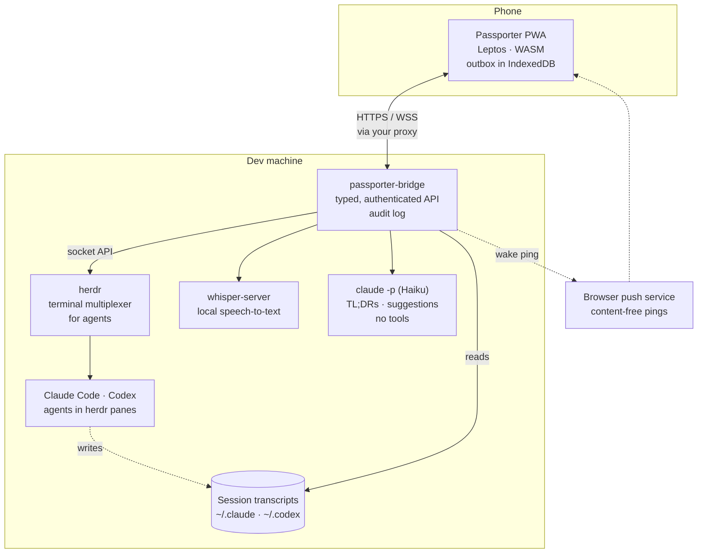

# Passporter

> [!NOTE]
> **Status.** The bridge and the phone web app (PWA) work today. The
> Android app, with native notifications and Android Auto, is planned and
> not built yet ([design §10](design.md#10-status-and-roadmap)).

## The system at a glance

herdr stays the source of truth: it runs the agents and knows their state.
The bridge wraps it in a small API with fixed verbs, reads each agent's
transcript for its thread, and serves the PWA. The bridge listens on
loopback; the phone reaches it through an HTTPS reverse proxy you choose,
such as Tailscale Serve.

## What it does

  <a href="app/triage.md"><strong>Triage in one glance</strong>
Blocked, Working and Done, blocked first, live over a WebSocket. A cached snapshot shows when offline.
</a>
  <a href="app/replies.md"><strong>Reply in one tap</strong>
Permission dialogs become chips; questions get suggested replies; a keypad answers anything else.
</a>
  <a href="app/dictation.md"><strong>Voice first</strong>
Record first, transcribe later, on your own GPU. A take survives tunnels and sends when signal returns.
</a>
  <a href="app/summaries.md"><strong>TL;DR of long turns</strong>
Outcome, changes, decisions and risks in four lines, plus a headline for every turn.
</a>
  <a href="app/terminal-mode.md"><strong>Run what the agent asks</strong>
Commands in an agent's message become chips; nothing runs without a confirm showing the exact text.
</a>
  <a href="app/runbooks.md"><strong>Runbooks and new agents</strong>
Start an agent in an allowlisted project, or run a named operation, by tap or by voice.
</a>

## Principles

- **herdr is the source of truth.** Passporter is a client: it never runs
  agents anywhere else.
- **Remote code execution with a nice UI.** The bridge can type into shells,
  so every action is a fixed verb, checked against the agent's current
  state, and written to the audit log before it runs ([Security](security.md)).
- **Agent output is untrusted.** It is rendered as text, never as HTML, and
  summarised by a model with no tools.
- **Offline tolerant.** Every reply is stored on the phone before it is
  sent, retried with the same idempotency key, and never sent stale without
  asking.
- **One thumb.** Primary actions sit in the bottom third; blocked is the only
  loud colour.

## Where to go next

| I want to… | Read |
| --- | --- |
| Install the bridge and connect a phone | [Quick start](start/quick-start.md), then [Deploy](deploy.md) |
| Learn what each screen does | [Using the app](app/triage.md) |
| Understand the moving parts | [System overview](architecture/overview.md) and the [design](design.md) |
| Check what protects the shell | [Security controls](security.md) |
| Diagnose a deployment | [`passporter doctor`](operations/doctor.md) |
| Change the code | [Contributing](development/contributing.md) and [Testing](testing.md) |
