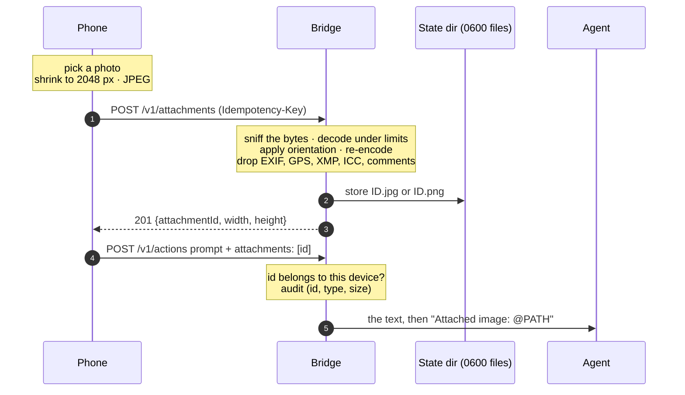

# Photo attachments

The composer's camera button sends a photo with a prompt: a screenshot of an
error, a whiteboard, a board on the bench. Nothing to configure.

## Using it

1. Tap the camera button and pick a photo, or take one.
2. The thumbnail appears; the upload starts at once, while you type.
3. Send. The prompt waits for the upload, then goes through the
   [outbox](replies.md#the-outbox) like any other, naming the photo by id,
   so a dead zone after the upload costs nothing.

Up to four photos per prompt.

## What the agent gets

The bridge types your text, then one line per photo with the stored file's
absolute path. **Claude Code** gets it as an `@` mention, which attaches the
image to the message itself with no tool call or permission prompt. **Codex**
gets the plain path and opens it with its `view_image` tool.

Nothing is written into the agent's repository, so attachments never show
in `git status`, and a hostile repository cannot redirect the bridge's
writes with a symlink.

## Privacy and limits

- Anything that is not really a JPEG, PNG or WebP is refused, whatever it
  claims to be. The pixels are encoded afresh: no camera metadata or
  location survives.
- 10 MiB per upload, 30 uploads per device per 10 minutes, at most 512
  stored at once.
- Each photo is deleted 7 days after upload; a prompt naming it after that
  is refused, and the phone says to attach it again.
- Prompts with photos are refused from the car.
- There is no way to read a photo back over the API.

Status codes and details: [Deploy › Photo attachments](../deploy.md#photo-attachments).
