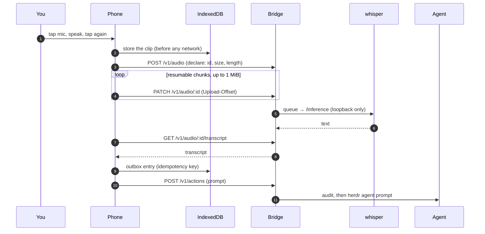

# Dictation

Typing is the worst way to answer an agent on a phone; speaking is the best.
Dictation is a primary input, not an add-on ([design §6.3](../design.md#63-dictation-first-class)).

## Using it

- **Tap** the mic (bottom centre of the dock, or the composer's), speak, and
  tap again. Or **hold** to talk and let go.
- The transcript is sent to the agent as a prompt, after anything already
  typed in the composer.
- **Cancel** while it transcribes discards the clip. If nothing was heard,
  nothing is sent.
- A take that sends never stops on silence (a pause mid-thought would send
  half a sentence). Only the length cap ends it early, and then it sends
  with a note.
- While the agent waits at a dialog, the words go into the composer instead:
  the bridge refuses prompts to a blocked agent, which answers with chips or
  keys.
- On an agent screen, an utterance that is exactly a [runbook](runbooks.md)'s
  name or alias offers that runbook behind its confirm instead of being
  sent.

**Review dictation before sending** (Settings, per device, off by default)
brings back a card with the transcript: **Use** fills the composer so you
can edit it first. With review on, silence auto-stop applies.

The microphone needs a secure context (HTTPS or localhost). In the insecure
MVP mode (plain HTTP) the mic button is not shown at all.

## How a clip travels

- **Record first, transcribe later.** The clip is in the phone's storage
  before anything touches the network. A tunnel mid-upload resumes from the
  last stored offset instead of starting over.
- **Audio stays home.** whisper.cpp runs on the dev machine, on loopback;
  the bridge is its only client. About half a second for an 11-second clip
  on a mid-range NVIDIA GPU with `large-v3-turbo`; a CPU build with a
  smaller model works too.
- **Retention.** Transcribed audio is deleted after a configurable period
  (`[audio] retention_hours`, a week by default; `0` deletes it as soon as it
  is transcribed). The transcript you send is a prompt in the audit log like
  any other.

Setting up the server: [Speech-to-text](../operations/whisper.md). Upload
caps, retries and the queue: [Deploy › Transcription](../deploy.md#transcription-whisper-server).
