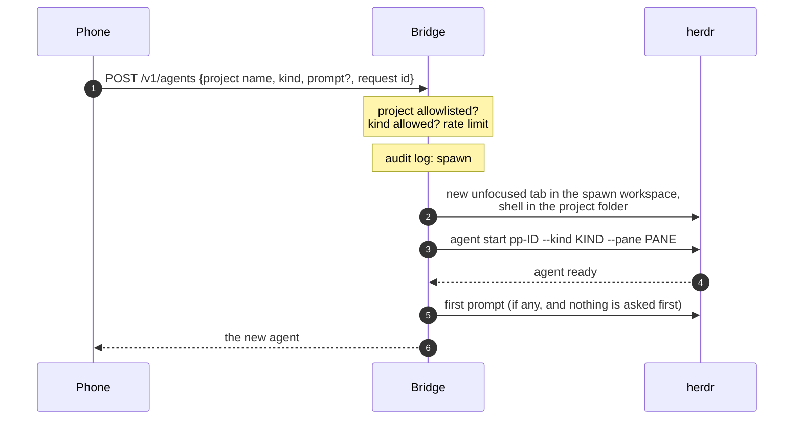

# New agents

The `+` beside the triage segments starts a new agent, but only in project
folders the bridge lists. It is off until the bridge config has a `[spawn]`
table.

## Using it

1. Tap `+`. A sheet lists the projects the bridge offers, by name.
2. Pick a project and the agent kind (Claude or Codex).
3. Optionally type or dictate a first prompt.
4. **Start.** Once the agent appears in the live list, the app opens it.

If the agent asks something before it is ready (Claude's folder-trust
dialog, say), the first prompt is not sent and the phone says so. Trust the
project folders in Claude once, on the dev machine, to skip that dialog.

A start that takes longer than about two minutes answers "still starting".
The phone keeps the request, even if you close the sheet, and tapping Start
again repeats it with the same request id: it never starts a second agent.

## What happens on the dev machine



- The phone sends only a project **name** and a kind the bridge offered;
  never a path or a flag. Nothing it sends reaches a command line.
- Claude starts in its normal permission mode, never with permission
  checks bypassed.
- Each device may start 6 agents per 10 minutes. Every spawn is in the audit
  log before herdr is asked for anything.
- Agents you start ping when they finish, like your own sessions.

## Turning it on

```toml
[spawn]
projects = [                         # the only folders an agent may start in
  { name = "passporter", path = "/home/you/git/passporter" },
]
# workspace = "passporter"           # default; the herdr workspace (by label)
# kinds = ["claude", "codex"]        # default
```

Then `systemctl --user restart passporter-bridge`. Names are short lowercase
slugs, unique; paths must be absolute. Full rules:
[Deploy › New agents from the phone](../deploy.md#new-agents-from-the-phone-spawn).
