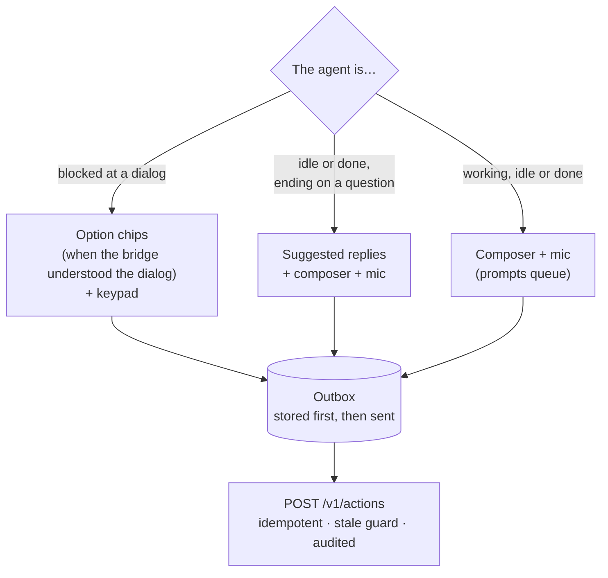

# Replies, chips and the keypad

The reply surface sits at the bottom of an agent's screen, above the dock
([design §6.2](../design.md#62-quick-reply)). What it offers depends on what
the agent is doing.

## Prompts

Type in the composer and send, or use the [mic](dictation.md). A prompt can
carry [photos](attachments.md). Prompts to the same agent queue behind each
other. Prompts starting with `!`, `/` or `#` (shell escapes, slash commands
and memory edits) are elevated and need the desktop for now.

## Dialogs: option chips

When an agent is blocked at a Claude Code or Codex dialog, the bridge reads
its screen and parses the question and options. With the
[Claude Code hook](../hooks.md) installed, the prompt and detail come from
the hook instead, so a long command or plan is shown whole.

Each option becomes a chip. Low-risk options (*Yes*, *No*, approve once)
send at a tap. **Elevated options** (*don't ask again*, *auto-accept*,
*bypass*, anything the parser does not recognise) are shown locked with the
reason "Needs confirmation on the desktop for now": they wait for step-up
authentication, which does not exist yet ([security](../security.md#step-up-and-app-lock)).

Chips answer exactly the dialog they show. Each `choose` names the dialog's
content-hashed id; if the agent moved to another dialog meanwhile, the
bridge refuses it (409) and the phone asks you to look again. It never
offers "send anyway" for a choice.

Where a permission dialog takes a note with its *No*, the note is sent as a
prompt once the *No* has gone through and the agent is back at its prompt;
otherwise it is put back in the composer.

## Questions: suggested replies

When a turn ends with a question ("Shall I proceed?"), the bridge generates
two or three short replies and the composer shows them as chips. A tap sends
one at once, as a prompt; a double tap still sends once. They are model
output about untrusted agent output, so they are re-checked on the phone
and only ever *offered*: nothing is sent without your tap. See
[TL;DR and summaries](summaries.md#suggested-replies).

## The keypad and the screen

If the parser cannot read a dialog confidently, there are no chips. Switch
to **Screen** to see the agent's terminal tail and use the **keypad**: digits
1 to 9, the arrows, Enter, Esc, Tab and Ctrl+C. You are never stuck.

The keypad answers what the screen *shows*, so it is disabled until the
screen on the phone is as new as the agent, and each key press carries the
state it was pressed against. A short cooldown swallows accidental double
taps. Ctrl+C (interrupt) is the emergency control: it never waits behind
anything else.

## The outbox

Every prompt, choice, key and interrupt is written to the phone's storage
with its own idempotency key **before** it is sent, then retried with
backoff until the bridge gives a definitive answer
([design §6.5](../design.md#65-offline-and-sync)).

| You see | Meaning |
| --- | --- |
| Queued · Waiting for a connection · Retrying | Stored on the phone; it sends when it can |
| Sending… | In flight |
| Sent | The bridge delivered it |
| **The agent moved on** | The agent's state changed before it arrived. Nothing was sent |
| **The dialog changed — check it again** | A choice or key that no longer applies. Nothing was sent |

A stale prompt becomes a decision card: **Send anyway as a new prompt**,
edit it, or discard it. A stale choice, key or interrupt is never resent:
what it answered is gone, so look again. The bridge never sends a stale
action on its own.

Replaying the same idempotency key returns the original result, so a retry
after a tunnel never sends twice.
