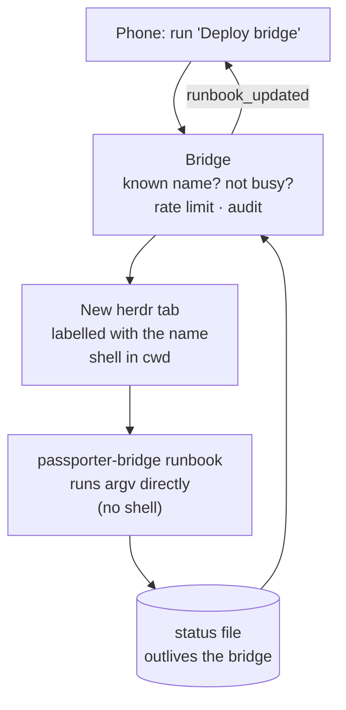

# Runbooks

A runbook is a named operation you set up on the dev machine ("Deploy
bridge", "Restart the dev server") and run from the phone. The phone names a
runbook and nothing else: there are no parameters and no free-form shell.

## Using it

- **By tap**: the terminal button in the triage header opens the Runbooks
  sheet, listing each runbook with its exact command and its latest run. A
  tap asks first (unless the runbook says `confirm = false`), showing the
  exact command and folder.
- **By voice**: on an agent screen, dictate a runbook's name or one of its
  aliases. An utterance that is exactly that, ignoring case, punctuation and
  filler words ("um", "please", "okay"), opens the same confirm instead of
  being sent to the agent. Speech always asks.

The sheet follows the run: running, then the exit code with the last lines
of output.

## What runs, and where



- `argv` runs exactly as configured, with no shell: no globbing, `$VAR`,
  pipes or `&&`. For those, point `argv` at a script in the repository.
- Each run gets its own unfocused herdr tab, labelled with the runbook's
  name, in the spawn workspace. Ctrl+C in the tab stops it.
- The run lives in your shell, outside the bridge's service sandbox, so a
  runbook may rebuild and restart the bridge itself; the restarted bridge
  picks the run up again and reports how it ends.
- One run per runbook at a time; 10 runs per device per 10 minutes; never
  from Android Auto. Every run is in the audit log with its exact `argv` and
  `cwd` before it starts, and again when it finishes.

## Configuring one

```toml
[[runbooks]]
name = "Deploy bridge"               # what the phone shows, sends and hears
aliases = ["deploy the bridge"]      # more phrases that offer it by voice
cwd = "/home/you/git/passporter"     # absolute
argv = ["deploy/bridge/setup.sh"]    # executed directly: no shell
confirm = true                       # default; a tap asks first (speech always asks)
timeout_secs = 600                   # default; killed after this long
```

Then `systemctl --user restart passporter-bridge`. Names and aliases must
sound different once case, punctuation and filler words are ignored. Full
rules: [Deploy › Runbooks from the phone](../deploy.md#runbooks-from-the-phone-runbooks).
