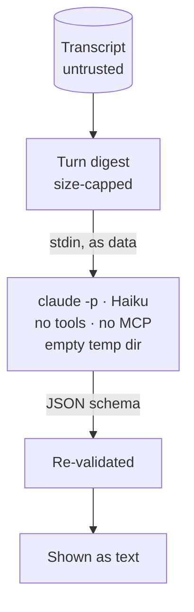

# TL;DR and summaries

Long agent turns (big diffs, long explanations) are unreadable on a phone.
The bridge asks a small model four things about them ([design §6.4](../design.md#64-tldr)):

| Summary | Of | Where it shows |
| --- | --- | --- |
| **TL;DR** | A long finished turn (over 1500 words of output, or more than 5 files changed), or any turn you ask for | A card under the latest finished turn, on the agent screen |
| **Headline** | Every finished turn, one sentence | Above each turn in the thread; on done agents' triage cards |
| **Status line** | The turn in progress: what the agent is doing now and what it waits on | Under a working agent's name in triage and at the top of its screen |
| **Suggested replies** | A question at the end of a turn | Chips in the composer |

## The TL;DR card

```text
Outcome:   one sentence — did it work?
Changed:   3–6 bullets (files and areas, lines added and removed)
Decide:    what it needs from you, if anything
Risks:     anything it flagged or skipped (failing tests, TODOs, assumptions)
```

It is generated eagerly when a long turn finishes, so it is usually ready by
the time you look, and cached per session and turn. **Summarise** on any
turn's header asks for that turn's TL;DR whatever its length; for the turn
in progress it is marked *so far*. **Read aloud** speaks the card where the
browser supports speech synthesis. The last card is kept on the phone, so it
shows offline with "as of 14:02".

## The thread is summary-first

By default each turn shows its prompt (two lines), its headline and, under
the latest finished turn, the TL;DR card. **Show full turn** reveals the
prose, tool calls and diffs; long messages fold to their first lines, runs
of tool calls fold into one row. The setting **Show full transcripts by
default** restores the whole transcript.

## Status lines

A working agent's status line is made from the tail of its turn and
refreshed every few minutes while the turn grows. Tap it on the agent screen
to ask for a fresh one (rate limited).

## Suggested replies

Generated when a turn that ends in a question finishes, before any
notification goes out, so they are ready when you open it. A tap sends one
as a prompt. Blocked agents get none: their dialog is answered with
[chips or keys](replies.md). Suggestions that look like commands (`!`, `/`,
`#` prefixes) are dropped.

## How they are made, safely



- The model is Claude Haiku through headless `claude -p`, using the
  dev machine's existing login: **no API key is stored**.
- Headless Claude is a full agent by default, so the bridge starts it with
  every tool disabled, no settings, hooks, `CLAUDE.md`, skills or MCP
  servers, no session persistence, a scrubbed environment and a fresh empty
  working directory.
- Output is constrained by a JSON schema, then re-validated and size-capped.
  It is rendered as text, never as HTML, and never executed.
- Failures back off per turn; an account usage limit pauses every
  generation for a while.

A malicious transcript can at worst produce a bad summary. Turn it off with
`[tldr] enabled = false`; the eval harness that measures quality and
injection resistance is [Summary eval](../eval.md).
