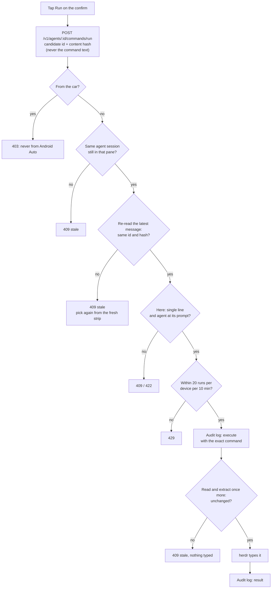

# Terminal mode

Agents sometimes need you to run something: "run `! gcloud auth login` so
the output lands here", "in another terminal, run `npm run dev`". Terminal
mode lets you do it from the phone without a terminal app. There is nothing
to configure: it works for Claude Code and Codex agents whenever the bridge
can read their transcript.

## Using it

1. A **Run** strip appears above the composer: one chip per command in the
   agent's latest message, in order. `!` marks the ones it wants in its own
   session, `new` the ones it wants in a terminal of their own. Every
   candidate is listed, so when the agent offers "this, or this" you see
   both and pick.
2. Tap a chip. The **confirm** shows the exact command and offers **Run here
   (!)** and **Run in new terminal**, the one the agent asked for first.
3. Tap one. Nothing runs without this second tap.

- **Here** types `!<command>` into the agent's prompt. Claude Code and Codex
  both run a `!` line as a shell command in their session, so the agent sees
  the output. Single-line commands only, and only while the agent is at its
  prompt.
- **New terminal** opens a herdr tab labelled `run: <agent>` with its shell
  in the agent's folder and types the command there. **Watch** then shows
  the tab's last lines, with Ctrl+C, Enter, Esc and the arrow keys. The tab
  stays in herdr when you are done.

> [!CAUTION]
> These are commands an agent suggested, run as you. Agent output can carry
> prompt injection. Read the confirm before you tap.

## What counts as a command

Fixed rules in the bridge pick candidates; no model is involved:

- a fenced code block labelled with a shell (`bash`, `sh`, `zsh`,
  `console`, …), or unlabelled when every line reads like a shell command;
- an inline code span the sentence asks you to run ("run", "type", "paste",
  … but not "I ran"), or one that is `!`-prefixed;
- a line of prose starting with `! `.

Paths, identifiers and code in other languages are left out. ANSI escapes
and hidden characters are removed, so what the chip shows is what runs. A
candidate is never cut: one over 2000 characters or 40 lines is left out
(and counted).

## The safety checks

- The phone names a command by **id and hash**, never by its text, so it
  cannot inject a command of its own.
- The bridge re-reads the agent's latest message and runs nothing if it
  changed.
- Every run is in the audit log, with the exact command, **before** anything
  is typed.
- Never from Android Auto. 20 runs per device per 10 minutes; 60 key sends
  per minute into a watched terminal, which only accepts allowlisted keys and
  only for terminals a run opened.

Configuration and limits in full: [Deploy › Commands from the agent's message](../deploy.md#commands-from-the-agents-message-terminal-mode).
