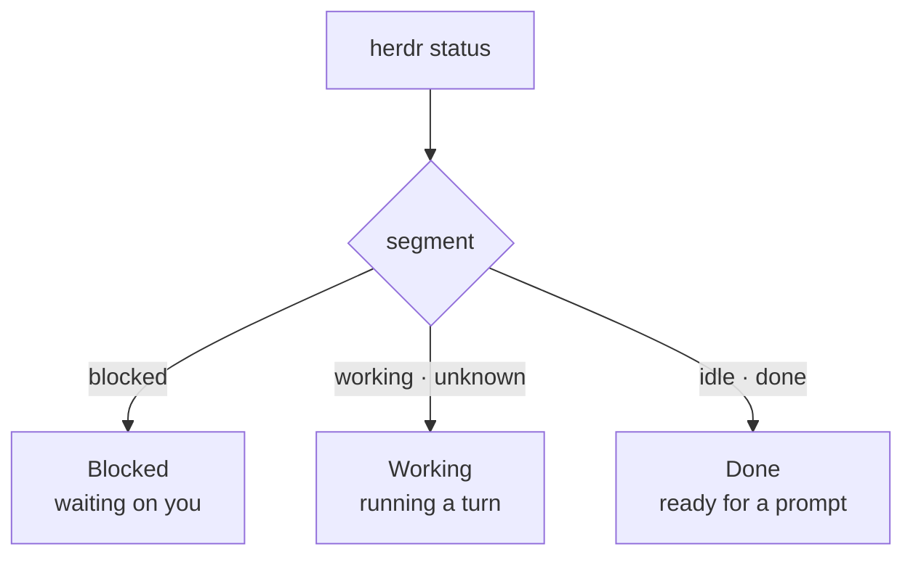

# Triage

Finding *which* agent needs you is most of the work of steering agents from
a phone. Triage answers it at a glance ([design §6.1](../design.md#61-triage)).

## The segments

Three segments sit just above the dock, in thumb reach: **Blocked ·
Working · Done**, blocked first. herdr's `idle` and `done` both count as
Done; an agent whose state herdr reports as `unknown` is shown with Working,
since it is neither waiting on you nor known to be finished.

Each state has its own hue: blocked is warm orange, working blue, done
green. Blocked is the only loud one, and the only state ever shown as a
filled surface.

## A card

Each card shows:

- the agent's name, or its terminal title when herdr has no name;
- an **unread dot** for a finished turn you have not opened yet;
- the **time in state** ("4m", "2h 5m");
- one line: what a blocked agent is asking, a working agent's **status
  line** (what it is doing now, with its age), or the **headline** of a
  done agent's last turn (see [TL;DR and summaries](summaries.md));
- a status label, and the repository and worktree it runs in.

Finished agents the bridge marks *quiet* (in a workspace or with a name
prefix you configure for automation, such as an orchestrator's reviewers;
see [push](../operations/push.md#quiet-agents)) are muted: another agent is
waiting on them, not you. They still show loudly when blocked.

## Moving between agents

- Tap a card to open the agent: its thread (or terminal screen) and the
  [reply surface](replies.md).
- Swipe left or right on an agent to move to the next one **in the same
  segment**.
- **Next blocked agent** in the header jumps to the next blocked one, wrapping
  around: an inbox-zero loop.
- The `+` beside the segments starts a [new agent](new-agents.md); the
  terminal button in the header opens [Runbooks](runbooks.md).

## Live and offline

The list is kept current by the bridge's event stream (`WS /v1/stream`):
state changes move cards between segments as they happen. When the stream
drops, a "Reconnecting to the bridge…" pill shows; the app reconnects with
backoff, and at once when the phone comes back online or to the foreground.

The last agent list is cached on the phone, so triage paints straight
away, marked "as of 14:02" until the stream confirms it. With no signal at
all, the cached list stays readable and anything you send waits in the
[outbox](replies.md#the-outbox).
