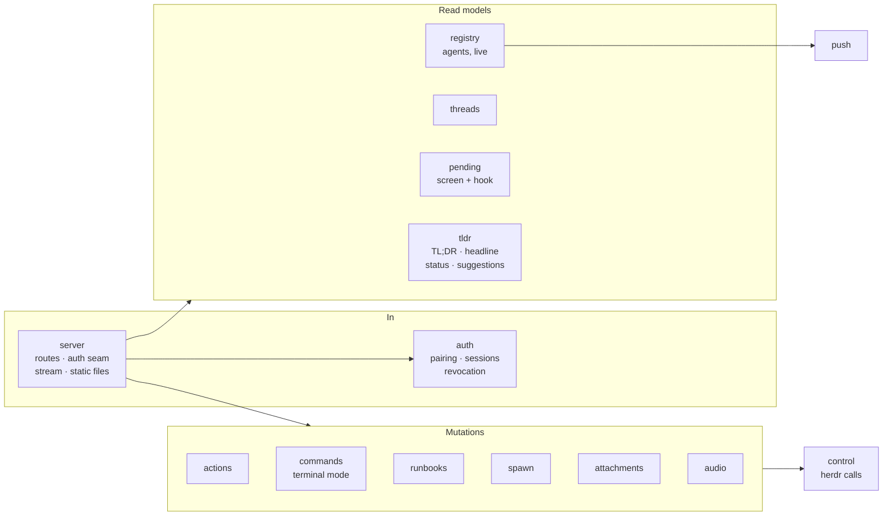

# Bridge

`crates/bridge` is the service on the dev machine. It follows herdr, reads
agent transcripts, and serves a small, typed, authenticated API plus the PWA
(axum, tokio, rustls; one static binary). Wire types come from
[`crates/protocol`](protocol.md); the bridge never redefines them.

The route list is [HTTP API](http-api.md), generated from the router. The
[bridge README](../../crates/bridge/README.md) has status codes and the
current simplifications ("MVP mode") with what replaces each.

## Binaries

| Binary | What |
| --- | --- |
| `passporter-bridge` | The service. `passporter-bridge push-keygen` makes the Web Push key; `passporter-bridge runbook <spec>` is the runner a [runbook](../app/runbooks.md) tab executes |
| `passporter` | The operator's CLI: `pair [--name]`, `devices list`, `devices revoke <id>` (over the bridge's admin socket) and [`doctor`](../operations/doctor.md) |
| `passporter-hook` | The [Claude Code hook](../hooks.md): forwards permission requests to the bridge over a unix socket, never answers them |

## Modules

| Module | Responsibility |
| --- | --- |
| `config` | The mode-`0600` config file; every key is documented in `config.rs`. Unknown keys are refused (typos fail at startup) |
| `registry` | herdr's agents as protocol `Agent`s, kept live from herdr events; broadcasts changes to the stream |
| `server` | Routes, the auth middleware, the event stream, static files with the single-page fallback, security headers |
| `auth` | Device pairing, signed 15-minute sessions, revocation; the admin socket the CLI uses |
| `threads` | One transcript reader per open agent, polled and pushed as `thread_items` |
| `pending` | What a blocked agent asks: parsed from its screen, with fuller text from the hook when it matches exactly |
| `tldr` | TL;DRs, headlines, status lines and suggestions, cached and generated eagerly |
| `actions` | `POST /v1/actions`: idempotency, rate limit, stale guard, policy, audit, then herdr |
| `commands`, `runbooks`, `spawn` | [Terminal mode](../app/terminal-mode.md), [runbooks](../app/runbooks.md), [new agents](../app/new-agents.md) |
| `attachments`, `audio` | [Photo uploads](../app/attachments.md); [dictation](../app/dictation.md) uploads, the transcription queue and retention |
| `push` | Content-free [Web Push](../operations/push.md) pings and device subscriptions |
| `control` | The herdr calls handlers make, behind a trait so tests use `FakeHerdr` |
| `tls` | HTTPS for the reverse proxy, with leaf reloads on change or SIGHUP |
| `doctor` | The read-only self-check behind `passporter doctor` |

## Rules every mutation follows

1. **Strict input.** Bodies deserialize into protocol types that reject
   unknown fields and validate sizes, ids and keys during parsing.
2. **Idempotent.** The same idempotency key replays the stored result and
   never sends twice; the same key with another body is a conflict.
3. **Rate limited** per device, except `interrupt`, which always works.
4. **Fresh state.** The bridge asks herdr for the agent now, and re-parses a
   blocked agent's screen, rather than trusting a cache.
5. **Stale guard.** If the agent's `state_change_seq`, session or dialog
   changed since you decided, the answer is `409 stale` and nothing is sent.
6. **Policy.** Elevated actions need step-up (refused until it exists); the
   car may do only a few low-risk things, and the origin of every action
   comes from the session's scope, never the request body.
7. **Audit first.** An `execute` entry is written and synced before herdr is
   called; if it cannot be written, nothing is sent. A `result` entry
   follows.

## Files

| Path | Holds |
| --- | --- |
| `~/.config/passporter/config.toml` | Settings (`0600`, in a `0700` directory the bridge checks); the static token only in insecure MVP mode |
| `~/.config/passporter/vapid.pem`, `tls/` | Push signing key; TLS leaf and key |
| `~/.local/state/passporter/audit.jsonl` | Append-only action log |
| `~/.local/state/passporter/devices.json` | Paired devices (public keys only) |
| `~/.local/state/passporter/admin.sock` | How `passporter pair` and `devices` reach the running bridge |
| `~/.local/state/passporter/{audio,attachments,runbooks}/` | Dictation clips, photos, runbook runs |

Every file mode and the systemd sandbox: [Deploy › Files and modes](../deploy.md#files-and-modes).
