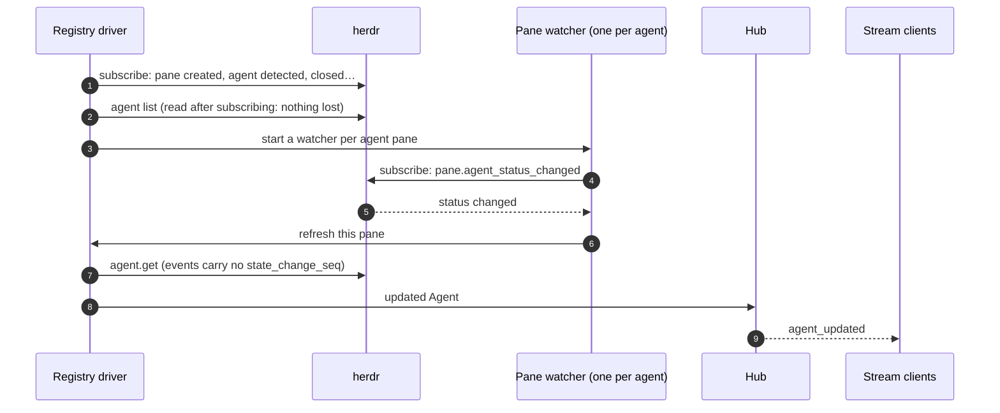

# herdr integration

[herdr](https://herdr.dev) runs the agents in terminal panes and is the
source of truth for their state. Passporter is a client: `crates/herdr` is a
typed client for herdr's socket API.

## The client

`SocketClient` speaks herdr's newline-delimited JSON over its unix socket,
one fresh connection per request, so a dropped connection affects only the
call in flight. Everything above it uses the `Herdr` trait:

| Calls | Used for |
| --- | --- |
| `agents`, `agent`, `read_agent` | The agent list, one agent's current state, its screen (viewport, recent output) |
| `prompt`, `send_keys` | Prompts and dialog answers (`POST /v1/actions`) |
| `workspaces`, `create_workspace`, `create_tab`, `run_in_pane`, `send_pane_keys` | Tabs for [new agents](../app/new-agents.md), [runbooks](../app/runbooks.md) and [terminal mode](../app/terminal-mode.md) |
| `start_agent_at_shell` | Starting an agent in a fresh shell pane, once its prompt has settled |
| `subscribe` | Event streams |

The bridge finds herdr's socket from `herdr_socket` in its config, else
herdr's own default. It never runs `herdr server` commands and never closes
panes, tabs or workspaces it did not create.

## Two semantics callers must respect

- **A timeout does not prove non-delivery.** A prompt that timed out may
  still have arrived. Inspect the agent's state before retrying; this is why
  every action carries an idempotency key and an expected `state_change_seq`.
- **`agent.prompt` refuses an agent at a dialog** (`agent_blocked`). Dialogs
  are answered with keys, which is why the phone puts dictation and
  suggestions into the composer while an agent is blocked.

## Keeping the agent list live

herdr reports status changes per pane, so discovery is two-level: one
lifecycle subscription tells the bridge when agents come and go, and one
watcher per agent pane triggers a re-read on every change. Events are only
triggers: the bridge re-reads the agent with `agent.get` because the stale
guard needs `state_change_seq` exactly. Refreshes are coalesced, failures
retry per pane with backoff, and the bridge reconnects to herdr with capped
backoff when it restarts.

## Agents and ids

An agent id is the pane id, plus `~<session>` when herdr reports the
agent's session. An id whose pane now runs a different session is 404 on
reads and `409 stale` on actions, so an answer can never land in a new
session that took over the pane. herdr's `idle` and `done` both mean "ready"
on the phone ([triage](../app/triage.md)).

## Testing without a live herdr

- **`FakeHerdr`** (feature `fake`): an in-memory model behind the `Herdr`
  trait, with scripted state transitions, for unit and integration tests.
- **`ReplaySocket`**: a real unix socket that answers with replies recorded
  from a live herdr, so the client decodes exactly the shape herdr sends.
- **The e2e fake**: a scripted herdr socket the real bridge binary talks to
  ([end-to-end tests](../development/e2e.md)).
- The live-herdr test is opt-in (`PASSPORTER_HERDR_IT=1`) and uses a named
  test session, never the one you are working in.
