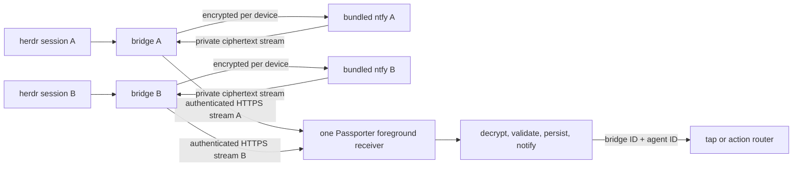

# Self-hosted native notifications

## Status

**Built (one bridge per phone).** A private ntfy companion behind the
bridge, never exposed: the bridge listens for it on loopback only
(`[push] native_ntfy`). Authenticated, app-scope bridge routes register a
per-device notice subscription at a reserved endpoint
(`POST /v1/push/native`) and proxy only that device's ciphertext stream
(`GET /v1/push/native/:id/stream`). The phone uses its existing native
pairing; it needs no ntfy app, account or token. Each notice is RFC 8291
ciphertext in an envelope signed with the bridge's VAPID key over a
domain-separated input (registration, expiry, ciphertext), so the
companion cannot forge one; the bridge spools envelopes durably while the
companion is down. The Android receiver is a narrow equivalent of ntfy's
subscriber around the existing connector's key manager: one foreground
service, one stream, a durable cursor. It is the default whenever the
bridge offers it; the external UnifiedPush path (T32a) remains as the
fallback and an explicit choice, one transport at a time. A deployment
generator (`deploy/session/create.py`) pins ntfy 2.37.2 by image digest.
See [operating it](../operations/push.md#built-in-delivery-android).

**Proposed next: one phone, several bridges.** The pairing registry,
picker, bridge-qualified notification and action identities and a
persistent bridge identity described below are not built yet. On the
Android app they mean making the shade and car outboxes, the reconciler,
`PairingReset` and the device stamps bridge-aware, which the first
version of this proposal (written before those existed) did not cover.

**Not validated on devices.** The JVM and integration tests cannot show
Doze, OEM battery savers, reboot or force-stop behaviour; see the device
gates below.

The sections below record the feasibility findings and alternatives that
led here. The public-ntfy and direct-stream options are not the
implemented default.

## Product boundary

One bridge owns exactly one herdr session, including the default session.
Several sessions require several bridges. One Android installation can pair
with several independent bridges and receive from all of them. Triage may
show one bridge at a time; background delivery must not follow UI selection.
There is no Passporter-operated relay or required third-party cloud.

Recommend a small native ntfy-compatible receiver inside Passporter, plus
an ntfy server bundled with each bridge deployment. Pairing provisions the
notification path automatically. Keep the existing external UnifiedPush
connector as an optional transport. Do not make Passporter a general-purpose
UnifiedPush distributor for other apps in the first version.

## Existing architecture and changes required

Reviewed `docs/design.md` (especially §§3, 5, 6.5–6.6, 8, 10 and decisions
D1, D4, D8), `docs/security.md`, Android development and push operations
docs, and the following implementation seams:

- `crates/herdr/src/client.rs`: one socket; explicit configuration, otherwise
  `HERDR_SOCKET_PATH`, otherwise the default socket. A service launched in a
  pane can inherit a named session. Generated deployments should record the
  selected socket explicitly, including for the default session.
- `crates/bridge/src/push/`: RFC 8291 encryption, VAPID, opt-in notices,
  per-device subscriptions, coalescing and host restrictions. The HTTPS sender
  uses port 443 and no redirects. It treats 404/410 as gone. Existing push
  TTL is one hour; do not assume ntfy enforces every Web Push header identically.
- `DeviceStore.kt`: one native device record, origin and Keystore alias.
  `PushStore.kt`: one registration, owned by a device id. A push decrypted
  for an older pairing is dropped (`IncomingPush.isCurrent`); retain that
  protection.
- `PassporterPushService.kt`: the UnifiedPush connector authenticates
  callbacks and decrypts; only decrypted, valid UTF-8 messages reach the
  notifier.
- `NoticeNotifier.kt`: deduplication and notification identity lack bridge
  context; `PairingReset` clears everything on any pairing change instead.
  `apps/android/src/destination.rs` opens an agent against the single
  saved origin. Neither is safe to generalize by adding sockets alone.
- The shell serves the paired bridge's PWA and grants native IPC to exactly
  that origin. Native identity, not the webview, authenticates background
  work: shade answers (`notify.actions`), Android Auto replies (`car`) and
  push all sign in natively and stamp every job with the device it was
  made for.

The old §10 roadmap proposed one bridge discovering multiple session sockets
and adding session names to agent IDs. This proposal supersedes that topology.
Keep agent IDs local to a bridge; use a bridge-qualified identity on the phone.
No multi-session discovery loop is needed in the bridge.

## ntfy source and licensing assessment

Inspected ntfy Android main at commit
`d9e11bad3e154ceb49702b3499318f02ef8419e0` (build declares 1.25.2), including
`settings.gradle`, `app/build.gradle`, manifest, `SubscriberService.kt`,
`WsConnection.kt`, `up/Distributor.kt` and LICENSE. These are source findings,
not a successful embedded build or a device test.

The project exposes a single `:app` module using `com.android.application`;
the inspected tree has no distributor library module or ready AAR integration.
The existing UnifiedPush connector dependency is the receiving client API,
not ntfy's persistent network receiver. `up/Distributor.kt` mostly forwards
messages to other apps; copying it alone does not provide delivery.

The real receiver is `SubscriberService`, tied to ntfy's Application,
Repository/database, ApiService, dispatcher, resources and settings. It groups
topics into one connection per server base URL, supports JSON and WebSocket
connections, uses `START_STICKY`, boot/restart receivers and a foreground
notification. Current Android 14+ code selects `specialUse`. The WebSocket
path resumes from stored message IDs and schedules reconnects with alarms,
including an exact-alarm permission branch. Source comments also describe
Firebase keepalives: the cloud-free path must explicitly exclude that branch.

Reusing this code requires extraction and ongoing maintenance, not merely a
Gradle dependency. Prefer implementing the narrow equivalent around a maintained
HTTP client: server stream, reconnection, durable cursor, bounded ciphertext
ingestion and the existing notice pipeline. Reuse audited encryption primitives;
do not invent crypto. Extract selected code only if a spike demonstrates less
work than that equivalent, preserving upstream attribution and change notices.
Do not copy ntfy's topic/endpoint debug logging into Passporter.

The inspected Android LICENSE is Apache-2.0, and the server's current LICENSE
is Apache-2.0. This permits a reuse route compatible with this workspace's
MIT OR Apache-2.0 declaration, subject to retaining licenses, copyright and
applicable NOTICE attribution and marking modifications. This is not a complete
dependency audit: pin the chosen revision/image, inspect per-file exceptions,
assets and transitive Gradle/Go licenses before shipping. `cargo deny` alone
does not cover them. See the pinned [Android sources](https://github.com/binwiederhier/ntfy-android/tree/d9e11bad3e154ceb49702b3499318f02ef8419e0),
[Android license](https://github.com/binwiederhier/ntfy-android/blob/d9e11bad3e154ceb49702b3499318f02ef8419e0/LICENSE)
and [server license](https://github.com/binwiederhier/ntfy/blob/main/LICENSE).

## Transport and deployment options

| Option | Benefit | Cost / decision |
|---|---|---|
| Bundled ntfy + internal native receiver | Existing encrypted publishing path; queue and resume support; no second app | Recommended first production candidate; adds a supervised service and provisioning adapter |
| Extract ntfy Android receiver | Reuses lifecycle experience | No ready library; large app coupling and fork upkeep; assess in a limited spike |
| Bridge-owned encrypted stream | One server process, one origin, existing device authentication | Feasible alternative; needs durable queue, acknowledgements/cursors, expiry, limits, backpressure and recovery; defer until measured |
| External UnifiedPush distributor | Existing working path; potentially shares a connection across apps | Optional advanced setting; distributor endpoint may be elsewhere and needs explicit host allowance |

Ship one deployment command/template per session that provisions bridge,
ntfy, private volumes, credentials, proxy routing and health checks. For
containers use a Compose project per bridge, with separate services on a
private network and no published ntfy backend port; for host installs use
companion systemd units. Do not put herdr itself in a new container merely
for notifications: its socket and transcript access remain host concerns.
Use distinct origins per bridge as the simplest supported layout. A companion
notification hostname avoids unverified ntfy subpath assumptions. Provision
DNS/TLS using the user's existing edge; no additional remote account is needed.

Expose only the HTTPS subscription route the phone needs, preferably over
the user's VPN. Publishing/provisioning/admin interfaces stay loopback/private.
If a shared public proxy is used, enforce route/method limits and protect
long-lived streams from proxy buffering and idle timeouts. A VPN must itself
remain available during sleep; this needs device testing. No bridge needs an
inbound connection to the phone. Disable Firebase, upstream forwarding, email,
attachments and other unused ntfy integrations. Bridge and ntfy start and
upgrade under the same deployment but have independent restart/health policy.

Pairing's authenticated native flow returns a versioned transport descriptor
and provisions one random topic and read credential per paired device, with
an internal publisher credential and deny-by-default ACLs. Automation must own
the provisioning lifecycle, not ask users to run ntfy commands. The spike must
choose a supported ntfy provisioning mechanism and exercise revoke/rotation
atomically; this integration is not present today.

Important compatibility issue: generic UnifiedPush ntfy endpoints expect
anonymous writes to secret capability topics. Do not grant anonymous `up*`
access for the internal path. Use authenticated internal publishing and exact
per-device read ACLs. The current sender has VAPID Authorization; ntfy bearer
authentication cannot simply be added as a second Authorization header.
Use a separate internal publisher adapter or local ingress authenticated by
its private network/socket boundary. Keep external UnifiedPush's capability
endpoint behavior separate. Verify ntfy's Web Push-to-stream binary framing,
base64 handling, VAPID behavior and cache semantics with captured synthetic
test vectors before choosing the adapter. References: [ntfy subscription API](https://docs.ntfy.sh/subscribe/api/),
[access control and UnifiedPush configuration](https://docs.ntfy.sh/config/#example-unifiedpush),
[UnifiedPush publishing](https://docs.ntfy.sh/publish/#unifiedpush).

A direct bridge endpoint should be a dedicated per-device encrypted notice
stream, not the UI's general agent WebSocket. It can reuse native device
authentication and avoid topics/ntfy credentials entirely. It still requires
offline retention and bounded replay; a socket alone loses notices while the
phone is disconnected. It has the same Android lifecycle problem as ntfy.
It could also produce ciphertext into an external distributor for the optional
path. Avoid implementing an entire ntfy or UnifiedPush server for this purpose.

## Identities and security invariants

Persist an opaque random BridgeId in each bridge's private state. Pairing must
bind that ID to the approved HTTPS origin and independent native credentials;
an unauthenticated version response or a payload's claimed bridge ID cannot
authorize a new origin. Labels and session names are display metadata. A
restored clone must not run alongside the original with the same identity;
document explicit identity regeneration and re-pairing for clones.

| Object | Required identity / boundary |
|---|---|
| Native pairing | BridgeId, approved origin, device ID, independent Keystore alias, pairing generation |
| Subscription | BridgeId, pairing generation, transport, registration ID, encryption key set, topic/endpoint |
| Notice | BridgeId, registration ID, message ID, agent ID, event/sequence, expiry |
| Shade / shortcut / conversation | BridgeId + agent ID; bridge-qualified group, tag and PendingIntent data URI |
| Action / reply / outbox | BridgeId + pairing generation + agent ID + pending ID / expectedSeq + idempotency key |
| Cache / cursor / retry / cleanup work | BridgeId and registration or pairing generation as appropriate |

The receiver derives bridge identity from its local connection/registration
record and verifies any encrypted envelope identity agrees. Never route by the
currently selected UI bridge or a URL from notification text. Never reuse a
key or token across bridges; forget/revoke A must leave B functional. Endpoint
replacement registers first, then retires the old endpoint with durable cleanup.
Late callbacks and queued work from a removed pairing must fail closed.

Retain RFC 8291 encrypted notices end to end from bridge to native receiver,
including over private networks. ntfy/proxy must see no agent names, prompts,
pending IDs or action content. They still observe timing, sizes, IP addresses
and opaque topics. Random topics are capabilities, not the sole authorization
control. Never log endpoint paths, tokens, decrypted payloads or key material.
Use bounded parsers, retention and queues; protect storage and exclude backups.

Encryption alone does not authenticate the publisher: anyone with the Web Push
subscription key material can encrypt. Internal ACLs restrict publishers;
for a uniform malicious-relay threat model add a versioned signature over the
notice envelope with a bridge signing key bound during pairing (not assumed
from an unchecked push header). Include identity, event ID and expiry in the
signature. Treat old unsigned external notices as informational only during
migration. Action labels are untrusted; actions always authenticate directly to
the bound bridge and revalidate pendingId/expectedSeq and existing risk policy.
No relay-delivered command executes automatically. Biometric step-up and the
existing security gaps remain separate hardening work.

The native registry must not become a credential oracle for bridge-served
JavaScript. Only the trusted local shell selects a bridge. A page from A may
invoke native APIs only for A; it cannot request B's tokens, switch privileged
context or enumerate B's private state. Switch origins by removing the old
remote capability and recreating/isolating the webview context before granting
the next one. Keep distinct origins and audit web storage isolation, outbox
workers and native IPC together. Merely allowing every paired origin in one
global capability is insufficient.

## Android feasibility: known limits and device gates

Use one foreground service for all internal connections, with a visible quiet
status notification and per-bridge connectivity state. Multiple origins mean
multiple network connections even though there is one service. Start the
service while the user enables notifications in the foreground; request Android
13+ notification permission and explain battery settings there. `specialUse`
is the candidate used by ntfy, with manifest justification. Future Play
distribution would need review; sideloading does not remove OS restrictions.
Do not classify an indefinite connection as time-limited `dataSync` merely to
obtain a foreground service. See [Android service types](https://developer.android.com/develop/background-work/services/fgs/service-types).

| Condition | Known / expected | Needs testing |
|---|---|---|
| UI closed, screen locked | The external path (T32a) delivers so; the built-in service runs without the webview | Embedded receiver on physical phones, prolonged idle, notification delivery latency |
| Deep Doze / battery saver | Foreground service alone does not guarantee unrestricted network; battery exemption helps | Exemption granted/denied, OEM restrictions, VPN sleep; overnight delivery and power use |
| Process death / recents swipe | Sticky services and persisted state enable recovery, not guaranteed immediate restart | OS kill, OEM recents behavior, task-manager stop; expose recovery status |
| Boot / app update | Boot receiver is possible, subject to background-start restrictions | Target SDK behavior, package replacement, locked boot; initially promise recovery after first unlock, not Direct Boot |
| Force-stop | No reliable self-restart until user interaction; do not work around it | Reopen recovery, expired backlog, Android 15+ canceled PendingIntents |
| Network change / outage | Stream resumes with stored cursor and bounded jittered retries | Wi-Fi/mobile/VPN switches, TLS failure, captive portal, proxy idle timeout |
| Several bridges | ntfy source supports several base URLs; one connection per independent server is feasible | 1/3/5 active bridges, one dead server, connection pool limits, fairness, battery/latency |

Doze limits network, jobs and alarms; WorkManager is suitable for durable
cleanup, registration and recovery, not a guaranteed immediate wake source.
Keep a running service alive while offline and wait for connectivity rather
than repeatedly attempting forbidden background foreground-service starts.
Use bounded wake locks only around ingestion/display. Do not require exact
alarms unless measurements establish a need. References: [Doze guidance](https://developer.android.com/training/monitoring-device-state/doze-standby)
and [Android stopped state](https://developer.android.com/about/versions/15/behavior-changes-all#enhanced-stop-states).

Retry independently per bridge with exponential backoff, jitter, Retry-After
and network awareness. Authentication failures require refresh or visible
re-pairing, not endless busy retries. TLS failures must never trigger HTTP or
trust-all fallback. Expired subscription means re-provision that bridge only.
Persist the message before advancing its cursor; use bounded bridge-qualified
deduplication for at-least-once delivery. Acknowledge/acceptance by ntfy is not
proof Android displayed it. Show last connection/message time separately from
registration success, and show notification permission/channel failures.

Set explicit queue size/age and signed expiry rather than trusting remote
cache TTL. On resume, drop expired notices and refresh authoritative state;
never replay an approval automatically. Gaps/overflow trigger reconciliation
when network allows. Keep notices self-contained so display needs no fetch
during Doze. Replies may have to queue offline and remain subject to stale
guards when connectivity returns. Document that bridge-host sleep/outage stops
new delivery; a companion on the same host is not an availability relay.

## Smallest staged implementation and migration

1. **Identity first, existing transport.** Add persistent bridge identity and a
   versioned native pairing registry with one entry initially. Qualify notices,
   callbacks, PendingIntents, deduplication, actions and storage now. Keep the
   proven external path. Migrate the old native record/key in place into one
   entry atomically; fetch/bind BridgeId through authenticated API. Never
   reassign old outbox entries to another bridge. Older bridges remain explicitly
   single-bridge legacy entries until upgrade, without inventing a trusted ID.
2. **Isolated feasibility spike.** One disposable bridge/session + companion
   ntfy + internal receiver, without general distributor IPC or production
   installation changes. Resolve provisioning, authorization/header handling,
   ciphertext framing, signed envelope and foreground-service lifecycle. Compare
   against a minimal direct-stream estimate after measuring, not after building
   two production transports. Decide go/no-go from physical-device results.
3. **Ship the default deployment and one-bridge receiver.** Pin ntfy, automate
   provisioning/revocation/rotation, add health/status UI and install/upgrade
   tests. Capability-negotiate signed transport versions; preserve PWA pings.
   Switching transport registers and tests the new path before removing the
   old one; deduplicate the overlap by the same logical event ID. Retain an
   explicit external-distributor setting and rollback without re-pairing.
4. **Expose several pairings.** Add the trusted native bridge picker, separate
   credentials and concurrent background reception, then badge counts across
   bridges. Qualify navigation and web/native authorization before enabling the
   second pairing. Route every tap/action independently of selected bridge.
   Build inline reply/Auto on these identities rather than retrofitting later.

Do not combine this with bundling the PWA, new CORS policy, a shared multi-session
bridge, or changes to live infrastructure. Forgetting a bridge cancels its
notifications, shortcuts, jobs and queued actions, clears its local data and
keys, and attempts server cleanup with bounded retry where possible. Local
forget while offline cannot guarantee remote deletion: provide the existing
operator revoke path and expire orphaned subscriptions. Other bridges survive.

## Verification plan and release criteria

- Unit/JVM: equal agent IDs and message IDs on A/B never collide; wrong
  bridge/generation, signature, expiry, malformed payload and old callbacks
  are rejected; intent identity, key isolation and per-bridge forget/revoke;
  cursor crash recovery and registration replacement; no secrets in logs.
- Protocol/integration: FakeHerdr for routine tests, explicitly named test
  sessions only for real socket coverage. Two bridges with matching pane IDs;
  signed encrypted delivery through actual pinned ntfy; permissions/read ACLs,
  wrong publishers, revocation, rotation, restart, cache expiry, slow clients,
  quota/429/5xx, duplicate and out-of-order messages, queue overflow and gaps.
  Test default-session socket selection without touching the live session.
- Android security: page A cannot invoke B's credentials; switching while a
  native call is in flight; stale taps after forget/re-pair; migrated storage,
  old PendingIntents, notification grouping and unchanged PWA behavior.
- Physical devices: Pixel/AOSP plus at least one restrictive OEM, oldest
  supported and current target Android. Record overnight locked delivery p50/p95,
  misses, restart recovery and battery versus idle baseline for 1/3/5 bridges.
  Exercise every lifecycle row above, with external distributor as comparison.
  Set acceptable latency/battery budgets before the trial; do not claim universal
  delivery or advertise force-stop delivery. Boot-before-unlock is out of scope
  initially. A denied exemption must produce honest degraded status.
- Deployment: fresh install is one setup flow, no ntfy app or manual service
  setup; test private/public edge, persistent volume ownership, upgrade/rollback,
  unhealthy companion, independent projects and secret-free diagnostics.
- Implementation gates: `just verify`, `just android-test` and `just gate`,
  plus pinned Gradle/Go/image license and vulnerability review. Device evidence
  is a separate release requirement; passing JVM tests cannot establish Doze
  reliability. No physical-device tests have been run for the embedded receiver.
