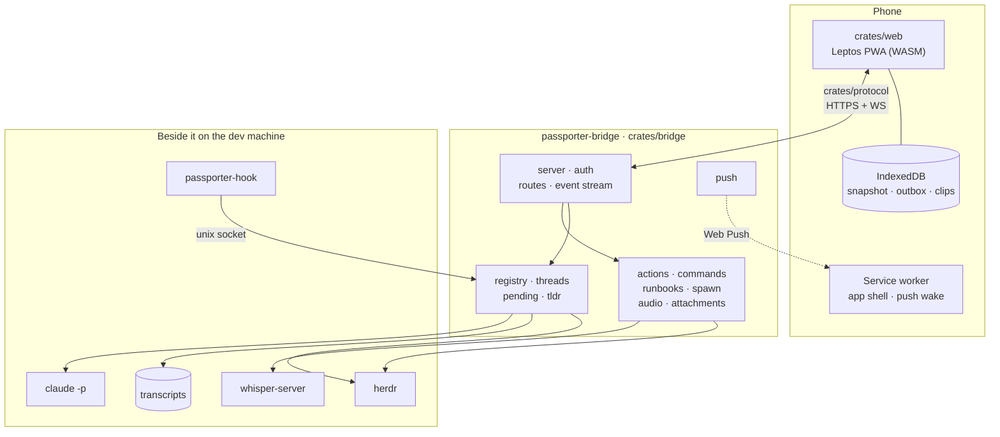
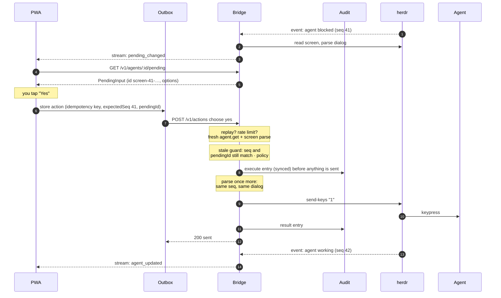

# System overview

Passporter is a Rust workspace. One service runs on the dev machine beside
herdr; one web app runs on the phone; a shared crate of wire types keeps the
two honest. The [design](../design.md) has the reasoning; this page is the
map.

| Crate | Role | Page |
| --- | --- | --- |
| `crates/bridge` | The service: wraps herdr and transcripts in a typed, authenticated API; serves the PWA | [Bridge](bridge.md) |
| `crates/web` | The phone app: Leptos compiled to WASM, offline-first | [Web app](web.md) |
| `crates/protocol` | Wire types compiled into both, so an API mismatch is a build error | [Protocol](protocol.md) |
| `crates/transcripts` | Claude Code and Codex session files as threads | [Transcripts](transcripts.md) |
| `crates/herdr` | Typed client for herdr's socket API, plus a fake for tests | [herdr integration](herdr.md) |
| `crates/summarize` | TL;DRs, headlines, status lines and suggestions through `claude -p` | [TL;DR and summaries](../app/summaries.md) |
| `crates/xtask` | Repository chores: pruning build output, scrubbing the corpus | [Transcript corpus](../corpus.md) |

## A request, end to end

Answering a permission dialog with a chip:

The same shape serves every mutating request: prompts, keys, interrupts,
[terminal mode](../app/terminal-mode.md), [runbooks](../app/runbooks.md) and
[new agents](../app/new-agents.md). Each is idempotent, checked against the
agent's current state, refused from the car where it must be, and audited
before it runs.

## Where things run

- **herdr** runs the agents in panes and is the source of truth for their
  state. The bridge talks to it over its unix socket.
- **The bridge** runs as a systemd user unit, as the same user, with a
  read-only file system except its state directory.
- **The phone** reaches the bridge through an HTTPS reverse proxy: Tailscale
  Serve or Caddy on the same machine (the bridge stays on loopback), or an
  edge proxy on another host that verifies the bridge's own leaf
  ([Deploy › HTTPS](../deploy.md#https)). Device pairing runs end to end, so
  a proxy can relay traffic but cannot mint sessions.
- **whisper-server** listens on loopback only; **`claude -p`** runs as a
  child process with no tools.
