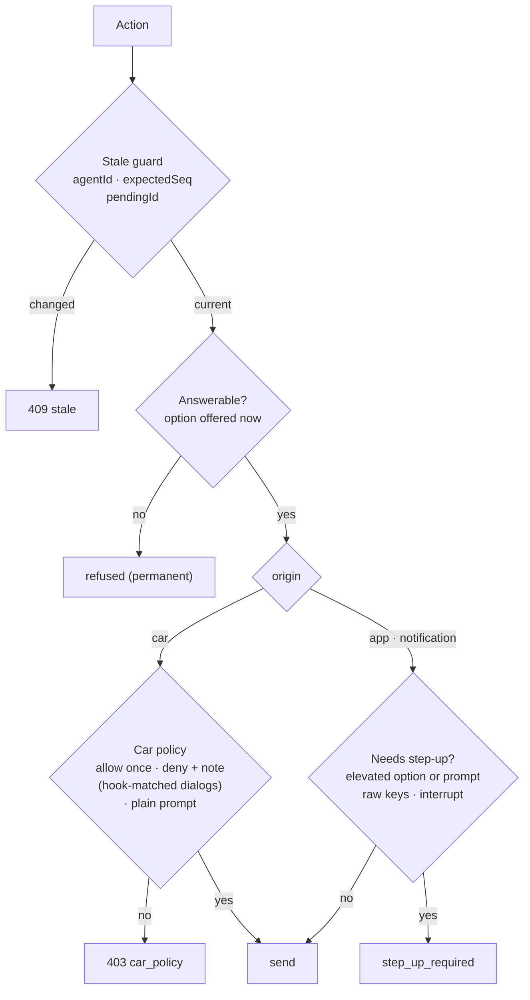

# Protocol

`crates/protocol` holds every type that crosses the wire. The bridge (host)
and the web app (WASM) both compile against it, so an API mismatch is a build
error rather than a runtime surprise. Its only dependency is `serde`.

## Conventions

- JSON field names are `camelCase`; enum values are `snake_case`.
  Timestamps are unix milliseconds.
- **Inbound types** (phone → bridge, such as `Action`) reject unknown
  fields and validate every field while deserializing, through the same
  constructors Rust callers use. A value of an inbound type is always valid:
  size limits, the key allowlist and id formats are enforced by the type,
  not the handler.
- **Outbound types** (bridge → phone, such as `Agent` and `AgentEvent`) are
  tolerant: unknown fields are ignored and open enums have an `unknown`
  fallback, so an older app keeps working against a newer bridge. Lists are
  read entry by entry, so one entry the app cannot read never hides the rest.

## The main types

| Area | Types | Used by |
| --- | --- | --- |
| Agents | `Agent`, `AgentId` (`<pane>` or `<pane>~<session>`), `AgentStatus`, `Seq` | `GET /v1/agents`, the stream |
| Threads | `ThreadPage`, `ThreadItem` (user and assistant messages, tool calls, diffs), cursors and epochs | `GET /v1/agents/:id/thread` |
| Dialogs | `PendingInput` (kind, prompt, detail, options with keys and risk, source, confidence) | `GET /v1/agents/:id/pending` |
| Summaries | `Tldr`, `Headline`, `StatusLine`, suggestions | TL;DR, thread, agent list |
| Actions | `Action` with kind `prompt`, `choose`, `keys` or `interrupt`; `ActionResult` (`sent`, `failed`, `stale`, `refused`) | `POST /v1/actions` |
| Keys | `AllowedKey`: digits, arrows, Enter, Esc, Tab, Ctrl+C | keypad, actions, terminals |
| Features | spawn, runbook, command, attachment and audio requests and results | their endpoints |
| Stream | `AgentEvent`: `snapshot`, `agent_updated`, `agent_removed`, `thread_items`, `pending_changed`, `tldr_ready`, `headline_ready`, `runbook_updated`, … | `WS /v1/stream` |
| Auth | pairing, challenge and session messages; `StreamAuth` | `/v1/auth/*`, the stream |

## An action

```ts
{
  idempotencyKey: string,  // made on the phone when you decide, offline too
  agentId: string,         // pane + session; both must still match
  expectedSeq: number,     // the agent's state_change_seq when you decided
  createdAt: number,
  kind: "prompt" | "choose" | "keys" | "interrupt",
  payload: …,              // { text, attachments? } | { pendingId, optionId, feedbackText? } | { keys } | {}
  origin: "app" | "notification" | "car",   // the bridge derives it from the session
}
```

## Policy, shared by both ends

`protocol::policy` is a set of pure functions over one classification, so
the bridge enforces them and the app pre-checks with the same code:



- **Elevated** means *always allow* / *don't ask again*, auto-accept,
  bypass, anything unrecognised, and prompts starting with `!`, `/` or `#`.
- **Step-up** (biometric confirmation) is not built yet, so elevated actions
  are refused, except raw keys and interrupt from the app, which are the
  keypad's only way to answer a dialog.
- **The car** may only choose *Allow once* or *Deny + note* on a dialog a
  Claude Code hook matched exactly, or send a plain prompt. Keys,
  interrupts, elevated options, runbooks, terminal commands and photos are
  unreachable from it. A car session (scope `car`) sets the origin of every
  action itself, whatever the body says, and reaches only the agent list,
  pending inputs, TL;DRs, `POST /v1/agents/:id/car-reply` (a spoken reply
  mapped by a tiny exact vocabulary) and car-origin actions. The bridge
  side is built; the Android app that would use it is planned.
