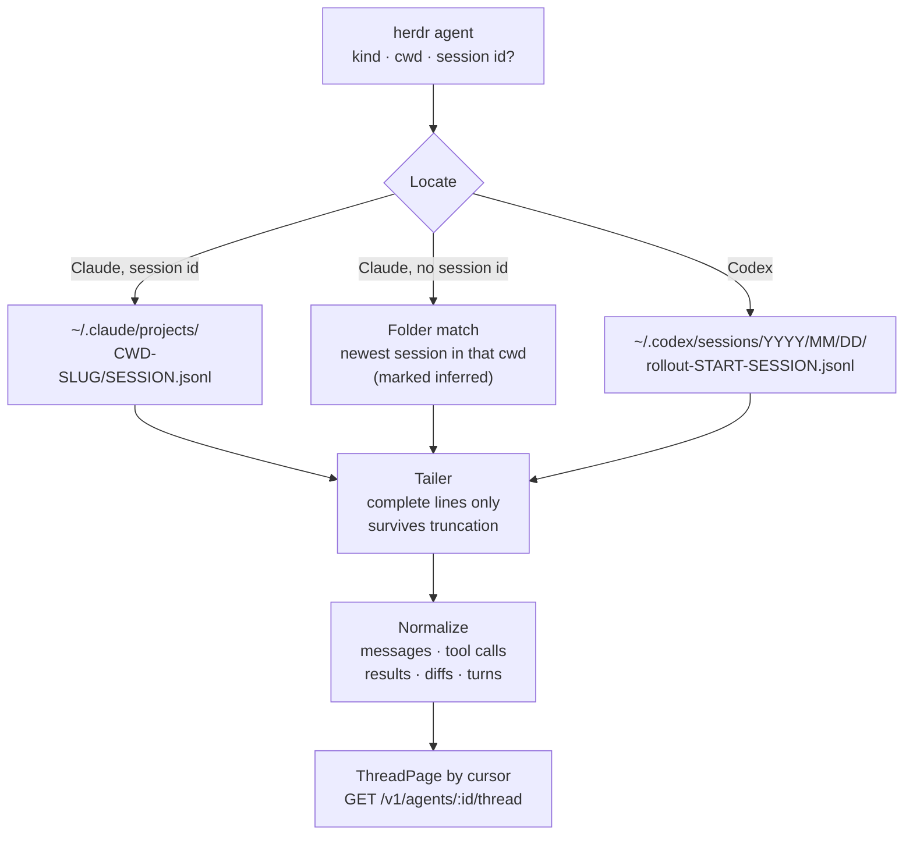

# Transcripts

What an agent said and did comes from its session transcript, not its
screen. `crates/transcripts` turns those files into the thread the phone
shows ([design §4](../design.md#4-data-sources-on-the-dev-machine)).

## Finding the file

- **Claude Code** appends each session to
  `~/.claude/projects/<cwd-slug>/<session>.jsonl`. herdr reports the session
  id when Claude's hooks are on.
- **Without a session id** (hooks off, as in the swarm), the bridge matches
  by folder: the most recently written session in that cwd's project
  directory, recent and started since the agent appeared. The match is kept
  while it lives, so it never flips between two agents in the same folder,
  and is replaced only when a newer file appears and the old one goes quiet
  (`/clear`, a restart in the pane). The thread says *inferred*.
- **Codex** writes `~/.codex/sessions/YYYY/MM/DD/rollout-<start>-<session>.jsonl`,
  found by session id, else by cwd. Nothing else under `~/.codex` is read: it
  holds credentials.

TL;DRs, headlines, status lines and suggestions are made only when herdr
reports the session id, never from a transcript guessed by folder.

## Following and normalizing

- A **tailer** follows the file as it grows, one complete line at a time,
  and survives truncation and replacement with bounded memory.
- Records become protocol `ThreadItem`s: user and assistant messages, tool
  calls with their results, and diffs from file edits (Codex: `apply_patch`),
  segmented into turns.
- The phone pages through them by cursor; when a transcript is replaced the
  **epoch** changes and the phone refetches from the start.
- On the bridge, one reader per open agent (at most 16) is polled every
  second, and changes are pushed to the phone as `thread_items`.

## Untrusted and undocumented

Transcripts are agent output and may carry prompt injection; their format is
undocumented and changes between releases. So reading never fails on
content: unknown record types and fields, odd shapes and invalid JSON are
skipped and counted, never fatal. Only I/O and caller mistakes are errors.
Rendered strings are size-capped and stay untrusted text for the phone to
render as text.

The parsing is tested against fixtures drawn from real sessions and, opt-in,
against a scrubbed corpus of real transcripts ([Transcript corpus](../corpus.md)).
