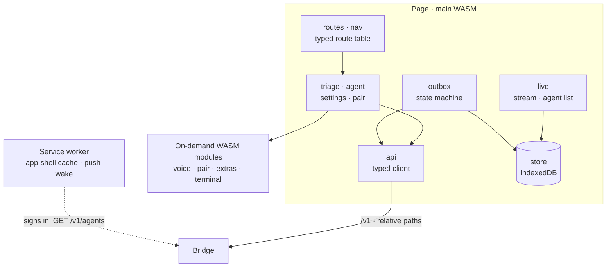

# Web app

`crates/web` is the phone app: a mobile-first PWA in Rust, Leptos 0.8
(client-side rendering) compiled to WASM with trunk. It runs on its own in
Chrome on the phone and is the UI the planned Android app will wrap. The
[web README](../../crates/web/README.md) is the detailed reference: layout,
CSP, service worker and size budget.

```sh
just web-build    # release build into crates/web/dist (the bridge serves it)
just web-size     # build, then fail if over the size budget
just web-serve    # serve on 127.0.0.1:8080 with the production CSP
```

## Shape



- **Library plus a two-line binary.** Everything except browser glue is
  unit-tested on the host with nextest; `web-sys` compiles everywhere and is
  only *called* in the browser.
- **Typed routes and API.** Every link goes through the route table; every
  request and response is a `crates/protocol` type.
- **Offline-first.** The agent list, the last TL;DR and the outbox live in
  IndexedDB. The service worker caches the app shell, so the app opens with
  no signal. A new version waits until you tap "New version available:
  Reload"; the app also compares its build with the bridge's
  (`GET /v1/version`).
- **On-demand modules.** Code a screen needs rarely (dictation, pairing,
  the sheets and Settings, the terminal-mode confirm, the push wake) is
  split into separate WASM modules loaded on first use, keeping the main
  bundle under its budget: 400 KiB gzipped, enforced by `just gate`.

## Security in the browser

- **Strict CSP**: `default-src 'self'`, no inline scripts or styles, no
  `data:` images, `connect-src 'self'`, `frame-ancestors 'none'`. The only
  hand-written JavaScript is the boot loader and the service worker.
- **Agent text is untrusted.** It is rendered as text nodes or through a
  safe Markdown renderer that builds elements itself, never as HTML. Links
  show the full URL and ask before opening.
- **API fetches** use relative paths, `redirect: "error"` (a redirect could
  carry the token elsewhere), `cache: "no-store"` and `credentials: "omit"`.
- **Device keys** are non-extractable WebCrypto P-256 keys, which need a
  secure context (HTTPS). Only the insecure MVP mode falls back to a pasted
  static token.

## UI rules in code

- One thumb: a fixed bottom dock holds Agents, the mic and Settings; the
  triage segments sit just above it.
- Every interactive element is at least 48 px.
- Dark by default: greys plus one hue per agent state. Blocked is the only
  loud one.
- No horizontal page scroll at 360 px; diffs scroll inside their block.
- Motion uses only transform and opacity, and stops under
  `prefers-reduced-motion`.
