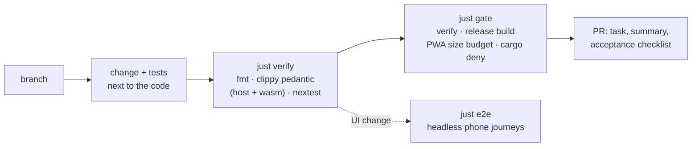

# Contributing

Passporter is a Rust workspace (edition 2024): the bridge, the WASM web app
and the crates they share. Read the [design](../design.md) before changing
code. [`AGENTS.md`](../../AGENTS.md) holds the rules agents follow; they
apply to people too.

## Set up

```sh
mise install     # just, trunk, nextest, cargo-deny, sccache, pinned in mise.toml
rustup show      # the toolchain pinned in rust-toolchain.toml, with the wasm target
just             # lists every recipe
```

`mise install` also fetches the JDK and the Tauri CLI that only the Android
app needs. To build the Android app, run `just android-setup` once for the
SDK, the NDK and the Rust Android targets ([Android toolchain](android.md)).

## The loop



| Command | Runs | When |
| --- | --- | --- |
| `just verify` | `cargo fmt --check`, clippy pedantic with `-D warnings` on host and wasm, every test | Before every push |
| `just gate` | `verify`, release build, the PWA's gzipped size budget, `cargo deny` | The merge gate, run locally |
| `just e2e` | The real bridge and PWA in headless Chromium against a fake herdr | UI and flow changes ([E2E](e2e.md)) |
| `just web-serve` | The PWA on `127.0.0.1:8080` with the production CSP | Working on the UI |

## Conventions

- **Lints apply to every crate**: no `unsafe`, no `unwrap()` outside tests,
  clippy pedantic.
- **Clear types over stringly data**, small modules, errors with context
  (`thiserror` in libraries), no dead code, doc comments on public items.
- **External input** is deserialized into `crates/protocol` types with
  strict serde (`deny_unknown_fields` on inbound requests).
- **Tests**: unit tests next to the code (`#[cfg(test)]`), integration tests
  in each crate's `tests/`, run with `cargo nextest`. New behaviour needs
  tests; every user-reported bug gets a failing reproduction first.
- **Dependencies** are added deliberately; each must pass `cargo deny`.
- **Agent output is untrusted** everywhere: in the UI, in summaries, in logs.
- **Never touch the herdr session you work in**: use `FakeHerdr` or a named
  test session.
- **Commits** are conventional (`feat(bridge): …`, `fix(web): …`). A PR body
  has `Task: <id>`, a summary, the checked acceptance list, and anything out
  of scope it touched, with the reason.
- **Docs** change in the same PR as the code they describe
  ([Writing the docs](docs.md)).

## Secrets and real data

Never read or commit secrets: `~/.config/passporter`, `.env*`, keystores.
Real transcripts are personal data: use the scrubbed corpus through
`$PASSPORTER_CORPUS`, never paste it into PRs or logs, and add only small,
hand-checked excerpts as fixtures ([Transcript corpus](../corpus.md)).
