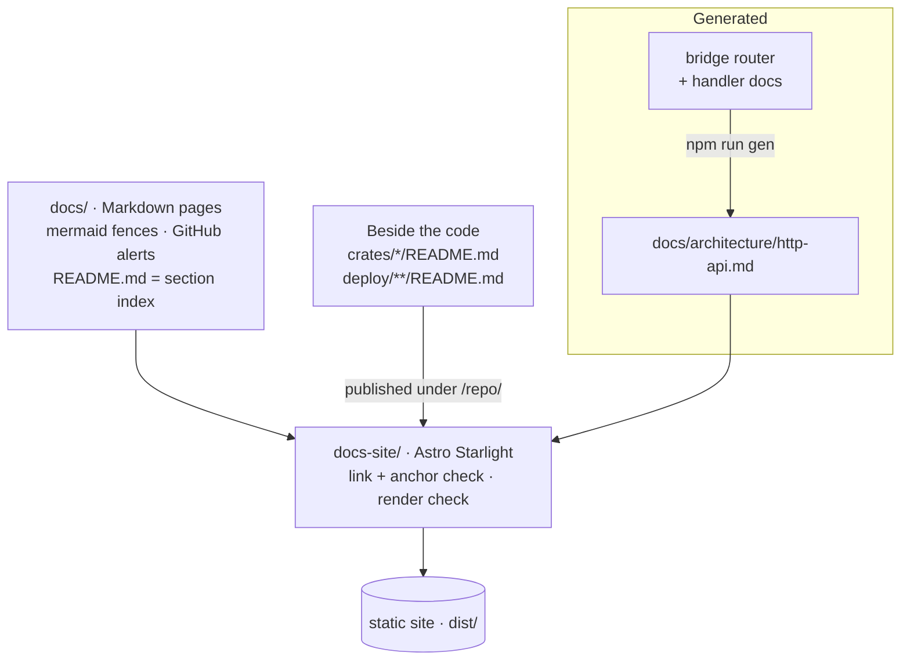

# Writing the docs

The documentation is the `docs/` directory: plain GitHub-flavoured Markdown
that reads well on GitHub as it is. The site in [`docs-site/`](../../docs-site/README.md)
is only a delivery layer (Astro Starlight) and can be swapped for another
generator without touching a page.



## Quick start

```sh
cd docs-site
npm ci              # once
npm run dev         # live preview on http://127.0.0.1:4321
npm run check       # tests, generated page up to date, build, link check, diagram render check
npm run shot -- /app/triage/ --light   # screenshot into docs-site/.shots/
```

Node 22 or newer. The render check and screenshots need a Chromium: a system
Chrome or Chromium is found automatically, `CHROMIUM=/path/to/chrome`
overrides it. The site is not part of `just gate`; the Rust gate has no Node.

| Command | Expect on success |
| --- | --- |
| `npm test` | The generator and check tests pass |
| `npm run gen:check` | `generated docs are up to date`, then `repository checks passed (N published pages, M patterns, 0 hits)`; a privacy hit fails with `check:repo: <file>:<line>: <kind> (<match>)` |
| `npm run gen` | `wrote N file(s)`: commit the changed generated page |
| `npm run build` | Astro's `Complete!` and no `invalid link` lines |
| `npm run check:render` | `checked N pages, M diagrams` and exit 0 |

## Writing a page

- **One H1**, the page's title. The site drops it and renders the title
  itself.
- **Relative links** to other pages (`../deploy.md#switching-to-tls`) and to
  code (`../../crates/bridge/src/config.rs`). Links to pages become site
  links; links to code go to GitHub. A link to a file that is not in Git, a
  missing page or a missing heading anchor fails the build.
- **Diagrams** are `mermaid` fences. Lead with one where it helps: a system
  shape, a request flow, a safety check. Avoid `<`, `>` and `;` inside
  labels.
- **Alerts** use GitHub's syntax (`> [!NOTE]`, `[!TIP]`, `[!WARNING]`,
  `[!CAUTION]`) and render as asides.
- **Frontmatter is optional.** New pages usually carry `description:` (the
  search snippet), `sidebar.order` (position in their section) and
  `sources:` (the files the page describes, shown as chips under the title).
  `pending: "PR #NN"` marks a page documenting code not merged yet.
- **No deployment specifics** in published pages: home directories, private
  addresses, internal hostnames, personal names and domains. Use
  placeholders (`/home/you`, `192.0.2.10`, `example.com`). `npm run
  check:repo` fails on any it finds; extra patterns can live in the file
  `PRIVATE_PATTERNS` names in `content-sources.mjs`.
- **Private-only text** goes in an `oss:private` block: a *begin* and an
  *end* marker, each an HTML comment on a line of its own. The site drops
  those blocks, so it publishes only the public text of every page.

## Where a page goes

The sidebar ([`docs-site/sidebar.mjs`](../../docs-site/sidebar.mjs)) groups
pages by the reader's path:

| Section | Directory |
| --- | --- |
| Getting started | `docs/start/`, plus `deploy.md` |
| Using the app | `docs/app/` |
| Architecture | `docs/architecture/`, plus `design.md`, `hooks.md` and the crate READMEs |
| Security | `security.md` |
| Operations | `docs/operations/` |
| Development | `docs/development/`, plus `testing.md`, `corpus.md`, `eval.md` |

A new page in one of those directories appears by itself, ordered by
`sidebar.order`. A new page anywhere else fails the build until it is given a
place in `sidebar.mjs`, so nothing is published unreachable.

## The generated page

[HTTP API](../architecture/http-api.md) is built from the bridge's router
(`crates/bridge/src/server/mod.rs`) and each handler's doc comment by
`docs-site/scripts/gen/http-api.mjs`. When you add or change a route, run
`npm run gen` and commit the page; `npm run check` fails while it is stale.
To improve a description, improve the handler's doc comment.

## Edit links

"Edit page" and source links point at `REPO_URL` in
`docs-site/content-sources.mjs`, a placeholder (`github.com/OWNER/passporter`)
until you set it to your repository. It is the only place the site names
one.

## How the site works

| File | What |
| --- | --- |
| `content-sources.mjs` | Which Markdown files are published, and the GitHub URL for source links |
| `sidebar.mjs` | The groups, their order, and the build-time checks that every page has a place |
| `src/lib/portable-loader.ts` | `README.md` → section index, H1 → title, READMEs beside the code → `/repo/…`, edit links and last-updated dates from Git |
| `src/lib/remark-portable.mjs` | Drops `oss:private` blocks; link rewriting, GitHub alerts → asides, `mermaid` fences |
| `src/lib/rehype-table-scroll.mjs` | Wide tables scroll sideways inside the column |
| `src/scripts/client.ts` | Mermaid rendering (theme-aware), the full-screen diagram viewer |
| `src/styles/theme.css`, `components.css` | Tokyo Night palette and components; the only place colours are defined |
| `src/overrides/` | Starlight overrides: source chips and banners under the title |
| `scripts/gen/` | The generator and its tests |
| `scripts/check-render.mjs`, `check-dev.mjs`, `check-repo.mjs`, `shot.mjs` | Headless render check, dev-server check, privacy scan, screenshots |

Replacing Starlight means honouring the same contracts: the content set,
`pathToSlug` for URLs, H1 titles, the remark and rehype plugins, GitHub-style
heading anchors, and a link and anchor check that fails the build.
