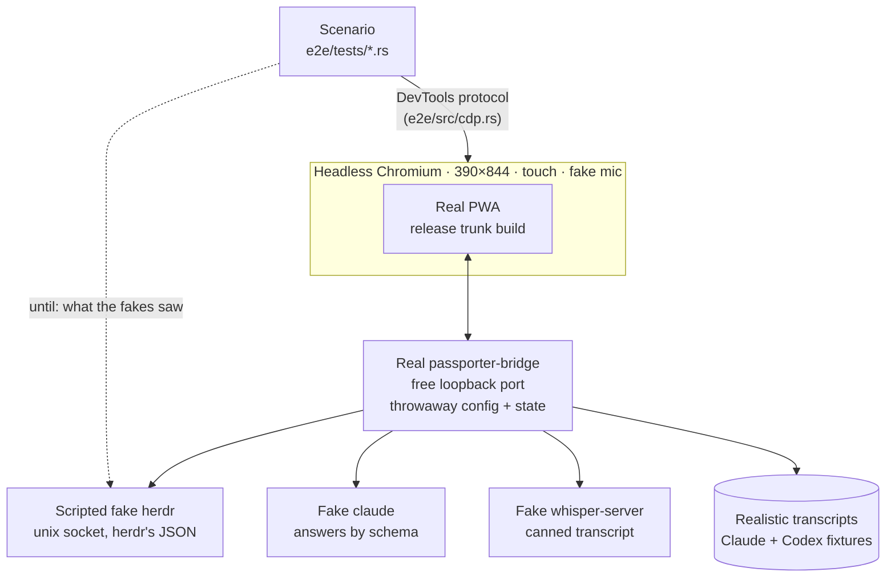

# End-to-end tests

`just e2e` drives the real app the way a phone uses it. It is opt-in (it
needs Chromium) and not part of `just gate`. The list of scenarios and every
environment variable are in [Testing](../testing.md#browser-smoke-tests-just-e2e).



## What is real and what is fake

- **Real**: the `passporter-bridge` binary with no test-only mode, and the
  release PWA, in system Chromium.
- **Fake herdr**: a unix socket speaking herdr's JSON protocol, pointed to by
  `herdr_socket`. It reports agents the way herdr really does (checked
  against recorded replies): some without a session, some without a name,
  labelled workspaces including the swarm's quiet one, and screens that tick
  between reads. It records keys and prompts, plays a shell for runbooks and
  new agents, and can fail a call.
- **Fake `claude`**: a script that answers the summarizer's structured
  requests by schema, so headlines, TL;DRs, suggestions and status lines run
  end to end without a model.
- **Fake `whisper-server`** with a canned transcript.

## Writing a scenario

- **Only the app's own code paths**: taps, typing, switching apps, the
  network failing. Never call a WASM module's exports or other internals.
- **Wait on what the page shows** (`expect`) or on what the fakes saw
  (`until`), never on time.
- **Fixtures follow reality**: when herdr, Claude Code or Codex is seen
  doing something new, add it to the fakes and fixtures first.
- **Every user-reported bug gets a failing e2e reproduction** before its
  fix.
- Shared steps live in `e2e/src/app.rs`. Every test also fails on console
  errors and uncaught exceptions.

## Running it

```sh
just e2e
```

It builds the PWA and the bridge, then runs the `#[ignore]`d tests. Without
Chromium it prints `e2e: SKIPPED` and exits 0. A failed step names what it
waited for and prints the page's text and the bridge's log.
