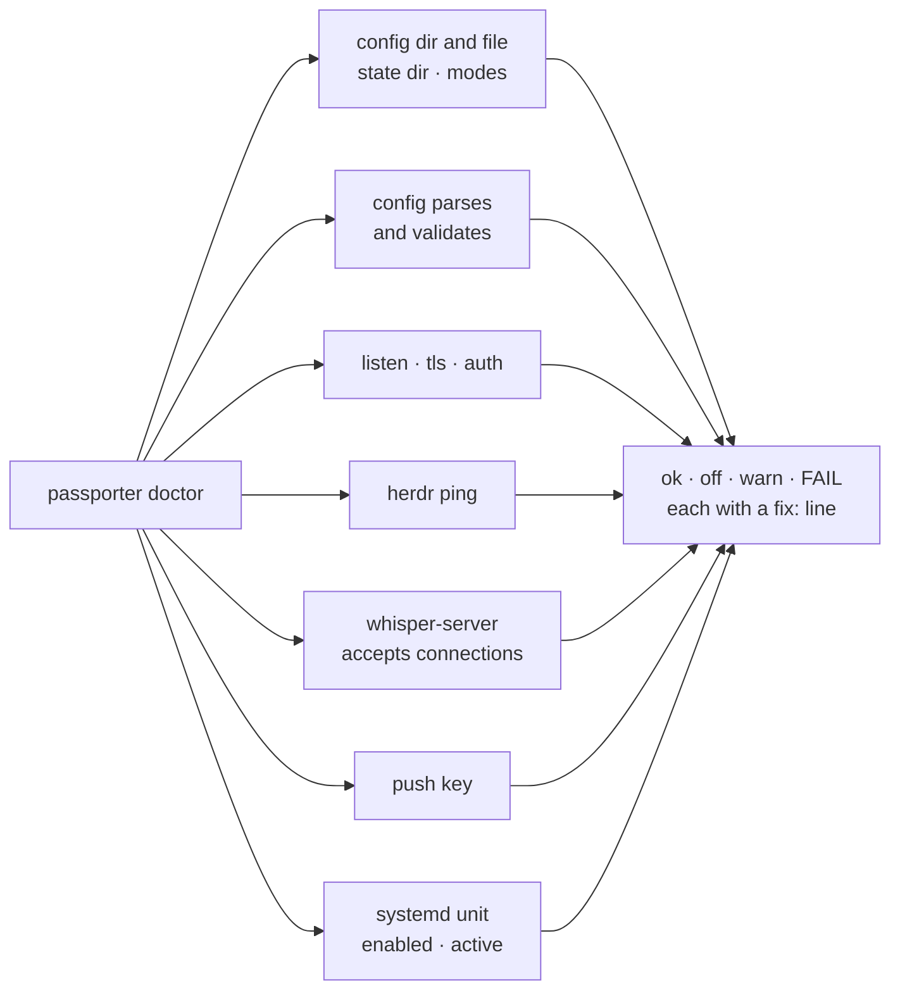

# passporter doctor

```sh
passporter doctor [--config-dir <dir>]
```

Run it after every install, upgrade or config change, as the bridge's user,
in a session with a systemd user manager.

**It changes nothing.** It reads files and their modes, pings herdr, opens
and drops a TCP connection to whisper-server and asks `systemctl --user`.
Every probe has a 3-second timeout, and they run concurrently. It never
prints a secret: the token is only checked for presence, and key files are
loaded, not shown.



## Reading the report

The report opens with the build of the `passporter` binary (commit and
build time), then one line per check:

| Result | Meaning |
| --- | --- |
| `ok` | Fine |
| `off` | An optional feature that is not configured (push, say) |
| `warn` | Works, but an MVP compromise or a trap |
| `FAIL` | Broken. The command exits non-zero |

Everything but `ok` comes with a `fix:` line.

## What a healthy deployment looks like

- **Quick start** (bridge on loopback behind Tailscale Serve or Caddy): no
  failures; whisper and push show `off` until you set them up.
- **Insecure MVP mode** (plain HTTP and a static token over WireGuard):
  warnings for the listen address, the static token and the missing HTTPS,
  by design.

## Common fixes

| Report says | Usually |
| --- | --- |
| config dir or file mode | `chmod 700 ~/.config/passporter && chmod 600 ~/.config/passporter/config.toml` |
| config | A key the bridge does not know (a typo) or an out-of-range value; the message names it without quoting the file |
| herdr | herdr is not running, or `herdr_socket` points elsewhere. A `HERDR_SOCKET_PATH` in your shell is ignored (and named): the unit does not see it |
| whisper | `systemctl --user status whisper-server` ([Speech-to-text](whisper.md)) |
| systemd unit | Not installed, not running, or running another `--config-dir`; re-run `deploy/bridge/setup.sh` |
| tls | Without `[tls]`: the bridge is not on loopback behind a local proxy (phones cannot pair). With it: the leaf is expiring within 14 days, does not match its key, or does not cover `tls.name` |

The full check table: [Deploy › Checking a deployment](../deploy.md#checking-a-deployment-passporter-doctor).
