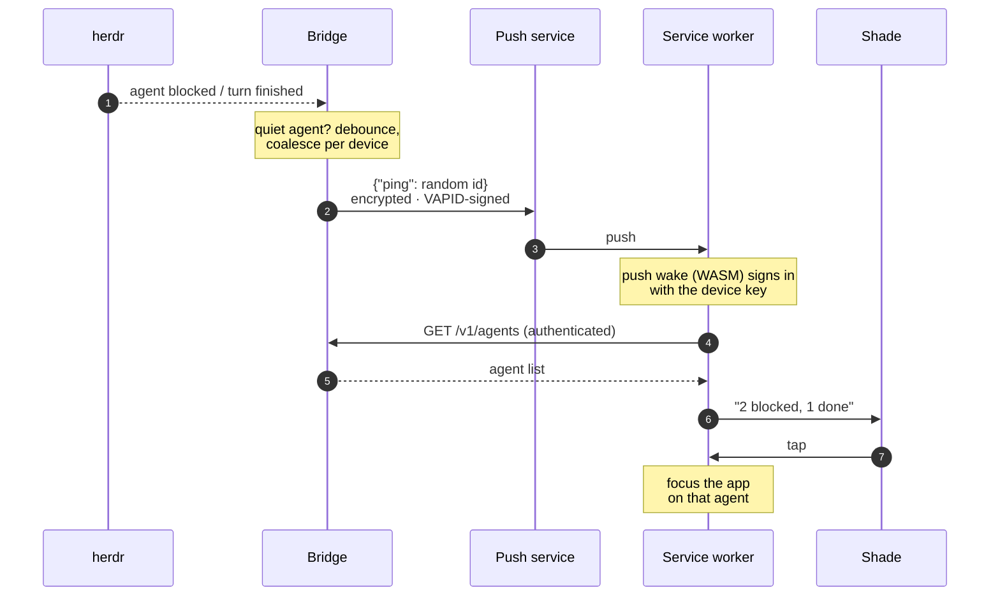

# Push notifications

When an agent becomes blocked or finishes a turn, your phone gets a
notification naming it. **No agent content ever reaches the push service**:
the bridge sends a content-free wake ping, and the phone fetches the actual
state over the authenticated API ([design §6.6](../design.md#66-notifications-and-android-auto),
decision D4).

## The flow



- The ping carries only an opaque random id, encrypted to the subscription
  (RFC 8291) and signed with the bridge's VAPID key (RFC 8292).
- Pings are **debounced and coalesced** per device: everything that happens
  before one fires rides on it.
- **Only news disrupts.** When a ping is due, the bridge checks its reasons
  again: a dialog already answered, an agent working again or a finished
  turn already read is dropped, and if nothing is left no ping goes out. A
  ping is only sent for a change since the last one.
- The notification names agents only, under one tag, so a new ping
  replaces the last notification. If the phone is offline or cannot sign in
  within 8 seconds, it shows a generic notification instead. If a push still
  finds nothing to report (a late race), the PWA never alerts.

## Quiet agents

Agents run by automation (an orchestrator's implementers and reviewers,
say) can be made to ping only when blocked, never for finishing a turn:
another agent is waiting on them, not you. An agent is quiet when its herdr
workspace is in `quiet_done_workspaces` or its name starts with one of
`quiet_done_agent_prefixes`. Both lists are empty by default, so every
finished turn pings. Agents you start from the phone are never quiet, and
quiet agents' finished cards are muted in [triage](../app/triage.md). Each
decision is logged with its reason:

```sh
journalctl --user -u passporter-bridge | grep 'finished turn'
```

## Turning it on

Push needs a secure context on the phone (service workers require HTTPS),
which every setup in [Deploy › HTTPS](../deploy.md#https) gives you.

```sh
passporter-bridge push-keygen      # writes vapid.pem (0600), prints the public key
```

```toml
[push]
subject = "mailto:you@example.com"   # the contact push services see
# quiet_done_workspaces = ["agent-swarm"]        # finished turns here never ping (default: none)
# quiet_done_agent_prefixes = ["impl-", "rev-"]  # nor those of agents named so (default: none)
```

Restart the bridge, then on the phone: **Settings › Notifications**. The
switch subscribes this device; turning it off unsubscribes it. Revoking a
device drops its subscriptions. `push-keygen` never overwrites a key: a new
key means every device subscribes again.

## Planned: the Android app

The bridge side is built; the app is not. A native subscription (through
UnifiedPush, for example a self-hosted ntfy allowed with `[push]
ntfy_host`) can opt into short **encrypted notices** instead of the bare
ping, because Android's Doze often blocks the fetch after a wake: per agent
with news, its name, state, one line, and the TL;DR *Decide* line once there
is one. They are end-to-end encrypted to the phone like the ping, so the
push service still sees only ciphertext. Android Auto would announce blocked
agents, and finished ones only when their TL;DR has a *Decide* line
(`car_announce_done`). See [design §6.6](../design.md#66-notifications-and-android-auto).
