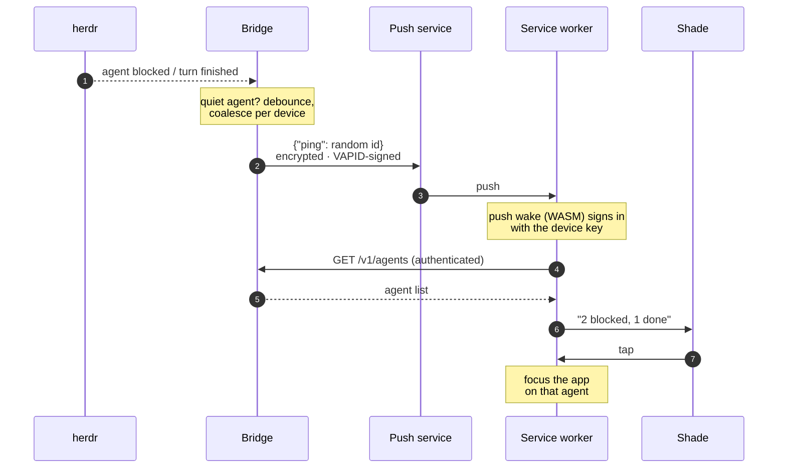
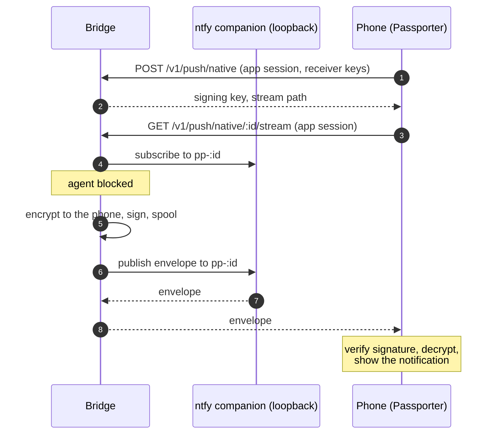

# Push notifications

When an agent becomes blocked or finishes a turn, your phone gets a
notification naming it. **No agent content ever reaches the push service**:
the bridge sends a content-free wake ping, and the phone fetches the actual
state over the authenticated API ([design §6.6](../design.md#66-notifications-and-android-auto),
decision D4).

## The flow



- The ping carries only an opaque random id, encrypted to the subscription
  (RFC 8291) and signed with the bridge's VAPID key (RFC 8292).
- Pings are **debounced and coalesced** per device: everything that happens
  before one fires rides on it.
- **Only news disrupts.** When a ping is due, the bridge checks its reasons
  again: a dialog already answered, an agent working again or a finished
  turn already read is dropped, and if nothing is left no ping goes out. A
  ping is only sent for a change since the last one.
- The notification names agents only, under one tag, so a new ping
  replaces the last notification. If the phone is offline or cannot sign in
  within 8 seconds, it shows a generic notification instead. If a push still
  finds nothing to report (a late race), the PWA never alerts.

## Quiet agents

Agents run by automation (an orchestrator's implementers and reviewers,
say) can be made to ping only when blocked, never for finishing a turn:
another agent is waiting on them, not you. An agent is quiet when its herdr
workspace is in `quiet_done_workspaces` or its name starts with one of
`quiet_done_agent_prefixes`. Both lists are empty by default, so every
finished turn pings. Agents you start from the phone are never quiet, and
quiet agents' finished cards are muted in [triage](../app/triage.md). Each
decision is logged with its reason:

```sh
journalctl --user -u passporter-bridge | grep 'finished turn'
```

## Turning it on

Push needs a secure context on the phone (service workers require HTTPS),
which every setup in [Deploy › HTTPS](../deploy.md#https) gives you.

```sh
passporter-bridge push-keygen      # writes vapid.pem (0600), prints the public key
```

```toml
[push]
subject = "mailto:you@example.com"   # the contact push services see
# quiet_done_workspaces = ["agent-swarm"]        # finished turns here never ping (default: none)
# quiet_done_agent_prefixes = ["impl-", "rev-"]  # nor those of agents named so (default: none)
```

Restart the bridge, then on the phone: **Settings › Notifications**. The
switch subscribes this device; turning it off unsubscribes it. Revoking a
device drops its subscriptions. `push-keygen` never overwrites a key: a new
key means every device subscribes again.

## The Android app

The [Android app](../development/android.md#push) cannot use Web Push (its
webview has none), and Android's Doze often blocks the fetch after a wake.
So its subscriptions opt into short **encrypted notices** rather than the
bare ping: per agent with news, its name, state, one line, and the TL;DR
*Decide* line once there is one. They are end-to-end encrypted to the phone
like the ping, so whatever carries them sees only ciphertext, and the app
shows them with no network at all. Inside the app the PWA's switch is
replaced by the app's own status light and *Set up* button.

They reach the phone one of two ways, one at a time:

- **Built-in** ([below](#built-in-delivery-android)), the default when the
  bridge has it: the bridge's own private ntfy companion holds them, and the
  app collects them from the bridge. Nothing else to install.
- **The ntfy app** (UnifiedPush): when the bridge has no companion, or when
  you choose it in the app's setup (*Use the ntfy app*). Allow the
  distributor's server with `[push] ntfy_host`
  ([Deploy › Push](../deploy.md#push-wake-pings-and-native-notices)).

Switching drops the other registration. A notice that arrives both ways
during a switch is shown once: the bridge gives all of a device's
subscriptions the same message id, which the app remembers.

## Built-in delivery (Android)



- **The companion is private.** ntfy listens on loopback, and the bridge
  refuses a `native_ntfy` that is not loopback. The phone talks only to the
  bridge, on its usual HTTPS origin, with its native device session: the
  registration and the stream are app-scope routes (a car session is
  refused), and a stream is only ever the caller's own registration, one at
  a time (a reconnect ends the stream the phone left). Device tokens never
  reach the companion. **Never proxy or expose the
  companion's port.**
- **The companion cannot forge a notice.** Each envelope carries the
  ciphertext, the registration it is for and an expiry (one hour), signed by
  the bridge's VAPID key; the app checks all three before decrypting, with
  the key the bridge named at registration. Another local user on the
  bridge machine can reach the loopback port: they can see ciphertext sizes
  and timing, or disrupt delivery, but not read, forge or answer a notice.
  On a shared machine that matters to you, isolate the port further.
- **Nothing is lost while the companion is down.** The bridge spools sealed
  envelopes in a private file (`push-native-spool.json` beside the
  subscription store; at most 256, 16 per phone, each for an hour) and
  publishes them in order once the companion answers (one it refuses for
  good, a 4xx other than 408 or 429, is dropped, never holding back the
  rest; anything else is retried). The companion
  keeps an hour of them for a phone that is offline. Delivery is at least
  once; the app drops a message it has shown.
- **The phone keeps one connection.** A foreground service (a quiet,
  minimised notification, *Listening for agent news*) holds the stream,
  reconnects with backoff, waits for a network, and starts again after a
  reboot (once you unlock) or an app update. If the bridge stops offering
  the transport (its companion removed), or Android refuses the service,
  the app falls back to the ntfy app on its own when you have used it
  before, and posts *Agent news stopped* (its tap opens the setup).
  After pairing, the app asks
  once to run without battery restrictions: without that, Doze may hold
  news back for minutes. A force stop ends it until you open the app.
- **A pairing change starts afresh.** Forgetting or re-pairing stops the
  stream and deletes the receiver's keys; the new pairing registers new
  ones, so whatever the old pairing's bridge still sends cannot be
  decrypted. Revoking the device on the bridge drops its registration.

### Turning it on

Run ntfy next to the bridge, on loopback, and tell the bridge where:

```toml
[push]
subject = "mailto:you@example.com"
native_ntfy = "127.0.0.1:2586"   # the companion; loopback only
```

Restart the bridge; the app registers the next time it opens (its
Settings › Notifications light turns on). For the companion itself, either
run the pinned image yourself, for example with Docker:

```sh
docker run -d --name passporter-ntfy --restart unless-stopped \
  --network host --read-only --cap-drop ALL --security-opt no-new-privileges:true \
  --user "$(id -u):$(id -g)" -v "$HOME/.local/state/passporter/ntfy:/var/cache/ntfy" \
  binwiederhier/ntfy@sha256:1875ddcf815c8a3c981d6d78c67a93452d0abba79b1ab9520b1f5f5238902bd7 \
  serve --listen-http=127.0.0.1:2586 --cache-file=/var/cache/ntfy/cache.db \
  --cache-duration=1h --keepalive-interval=20s \
  --visitor-request-limit-exempt-hosts=127.0.0.1 --visitor-subscription-limit=64
```

(make the cache directory first, mode 0700; the last two flags lift ntfy's
per-visitor limits, a request burst of 60 and 30 subscriptions, which the
bridge, its only client, would otherwise hit), or generate a whole new
deployment for one herdr session with
[`deploy/session/create.py`](../deploy.md#a-new-deployment-with-the-built-in-transport).
The image is ntfy 2.37.2, pinned by digest. Your HTTPS proxy must pass the
stream through unbuffered and leave it open: the companion sends a
keepalive every 20 s, and the app reconnects when its session (15 min)
ends.

Android Auto announces blocked agents, and finished ones only
when their TL;DR has a *Decide* line (`car_announce_done`). See
[design §6.6](../design.md#66-notifications-and-android-auto).
