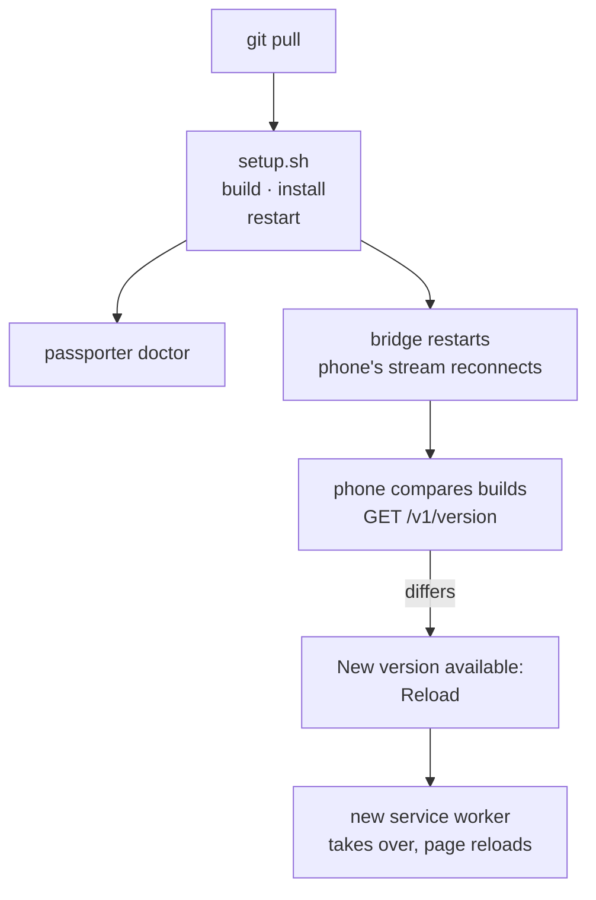

# Upgrades

```sh
git pull
deploy/bridge/setup.sh
passporter doctor
```

Re-running `setup.sh` rebuilds and reinstalls both binaries and the PWA,
reinstalls the unit and restarts the bridge. It never touches your
`config.toml`; if a newer bridge refuses a setting, the log and `passporter
doctor` name the line and the fix.



## What is running?

- `curl -s <bridge>/v1/version` gives the bridge's commit and build time
  (`-dirty` for a modified tree). It needs no token.
- The bridge logs the same at startup; `passporter doctor` shows the CLI's
  own build.
- On the phone, **Settings › About** shows the app's build and the
  bridge's.

## How the phone updates

A new service worker never takes over by itself mid-session. When the
bridge restarts after a deploy, the phone's stream reconnects, the app asks
for a new worker and compares its build with the bridge's. If they differ
it shows **New version available: Reload**. Reload hands over to the new
worker, which drops the old app-shell cache, and the page reloads. If the
bridge serves an older PWA than it runs, Settings says to rebuild the PWA
(`just web-build`).

## If the bridge does not come back

```sh
journalctl --user -u passporter-bridge -e   # names the config line it refuses
passporter doctor                           # the same, with a fix for each problem
```

Sessions live in memory, so a restart signs paired phones out until they
sign their next challenge, which happens automatically. Idempotency results
do not survive a restart either; the stale guard catches most retries that
arrive after one.
