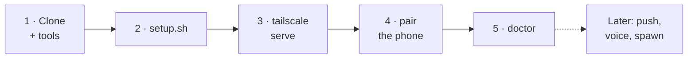

# Quick start

**Use this when** you are setting Passporter up for the first time. This is
the shortest path: the bridge on loopback, Tailscale Serve for HTTPS, and a
paired phone. The full reference, including other HTTPS setups, push and
every optional feature, is [Deploy](../deploy.md).

**How it gets on your phone.** There is no app-store app: the bridge
serves the phone app itself. You open the bridge's address in Chrome on the
phone, pair once, and add it to the home screen, where it opens like an app.
How the phone reaches that address is up to you (a VPN such as Tailscale, or
a reverse proxy), with one rule: it must be HTTPS with a certificate the
phone already trusts, or pairing, the microphone and push will not work.
Tailscale Serve, used below, gives you both the private route and the
certificate in one command.

| | |
| --- | --- |
| Runs on | The Linux machine where herdr and your agents run, as the same user |
| Phone | Android with Chrome (tested). iPhone with Safari is untested |
| You need | herdr, Claude Code or Codex, the Rust toolchain via rustup, `trunk` (or [mise](https://mise.jdx.dev)), and [Tailscale](https://tailscale.com) on the machine and the phone, with HTTPS certificates enabled |
| Typical time | 15 minutes, most of it the first build |
| Changes | Installs two binaries to `~/.local/bin` and one systemd user unit |



## 1. Clone and install the tools

```sh
git clone https://github.com/jacobporter6/passporter && cd passporter
mise install        # just, trunk, nextest, cargo-deny (pinned in mise.toml)
```

The Rust version pinned in `rust-toolchain.toml` installs itself on the
first build. Without mise: `cargo install trunk --locked`.

## 2. Build, install and start the bridge

```sh
deploy/bridge/setup.sh
```

The script builds the bridge and the PWA, installs `passporter-bridge` and
the `passporter` CLI, writes a pairing-only `~/.config/passporter/config.toml`
(mode `0600`; the bridge on `127.0.0.1:8443`, trusting the local proxy), and
starts `passporter-bridge.service` as a systemd user unit. Re-running it is
safe; it never touches an existing config. `--help` lists its options.

To keep the bridge running while you are logged out:

```sh
loginctl enable-linger "$USER"
```

## 3. Give it an HTTPS name

```sh
tailscale serve --bg --https=443 http://127.0.0.1:8443
```

The bridge is now at `https://<machine>.<tailnet>.ts.net/`, with a publicly
trusted certificate, reachable only from your own devices. No domain, no
CA, no open ports. The PWA needs HTTPS for pairing, its offline shell,
push and the microphone. Other options, such as Caddy with a domain or your own
edge proxy, are in [Deploy › HTTPS](../deploy.md#https).

## 4. Pair the phone

```sh
passporter pair            # a QR code and a code, single use, 5 minutes
```

On the phone, open `https://<machine>.<tailnet>.ts.net/` in Chrome, scan the
QR code or type the code. The phone makes a key that never leaves it and
signs in with it from then on. Triage appears with your agents, blocked
first.

> [!TIP]
> Install it: Chrome's menu › **Add to home screen**. The app shell is
> cached, so it opens instantly even with no signal.

## 5. Check the deployment

```sh
passporter doctor
```

Every line is `ok`, `off`, `warn` or `FAIL`, and anything but `ok` comes
with a `fix:` line. A healthy quick-start deployment reports no failures;
whisper and push show `off` until you set them up. See
[`passporter doctor`](../operations/doctor.md).

## Turn on the rest, when you want it

| Feature | What to do | Page |
| --- | --- | --- |
| Notifications | `passporter-bridge push-keygen` and a `[push]` table | [Push](../operations/push.md) |
| Dictation | Build `whisper-server` with `deploy/whisper/build.sh` (CUDA or CPU) | [Speech-to-text](../operations/whisper.md) |
| New agents from the phone | A `[spawn]` table listing allowed project folders | [New agents](../app/new-agents.md) |
| Runbooks | `[[runbooks]]` tables naming fixed commands | [Runbooks](../app/runbooks.md) |
| Summaries | The `claude` CLI, logged in, on the same machine | [TL;DR and summaries](../app/summaries.md) |
| Fuller dialog text | Install the Claude Code hook | [Claude Code hooks](../hooks.md) |

After any change: `systemctl --user restart passporter-bridge`, then
`passporter doctor`.
